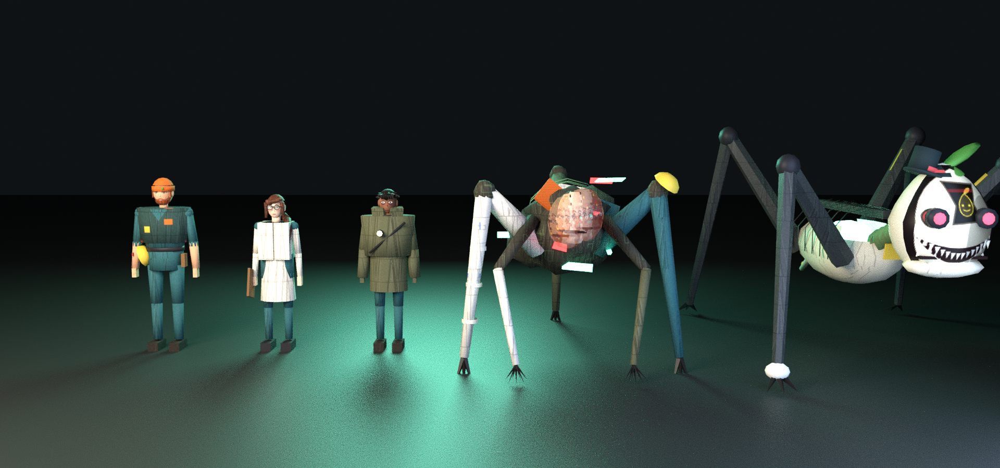
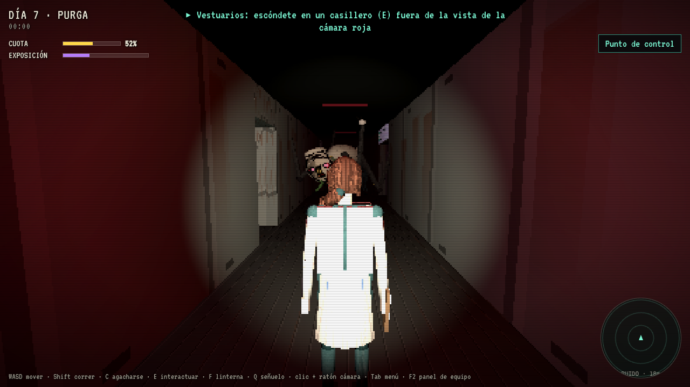

# PLOT ZERO · Cultivo Cero

> *Tres pasantes de Arcadia Eden Corp. cultivan una planta luminosa durante siete días en un planeta oscuro, guiados por PIP, la simpática mascota de la empresa. Cada noche, algo camina entre los cultivos. Uno de los tres empieza a notar que el cielo tiene costuras, que la mascota miente… y que alguien, al otro lado de la pantalla, le mueve las manos.*

Terror co-op de 1 a 3 jugadores: granja de día, supervivencia de noche y una cuarta pared que te mira de vuelta. Lanzamiento previsto en **Roblox** y después una edición ampliada en **Steam**.





## Qué hay en este repositorio

| Ruta | Contenido |
|---|---|
| [`docs/00-historia/historia-completa.md`](docs/00-historia/historia-completa.md) | **La historia completa (canon v0.2)**: trasfondo y cronología, personajes, las dos amenazas, la base, las fases del día, tareas, archivos de recuerdo, los siete días, la Purga tramo a tramo y los cuatro finales |
| [`docs/01-analisis/analisis-idea-y-mercado.md`](docs/01-analisis/analisis-idea-y-mercado.md) | Análisis de la idea, huecos de trama y sus soluciones, Roblox frente a Steam, probabilidad de éxito e ingresos |
| [`docs/02-diseno/biblia-del-juego.md`](docs/02-diseno/biblia-del-juego.md) | Biblia de producción: dirección de arte, fichas de diseño v0.1.0, sistemas, interfaz, sonido y galería |
| [`docs/03-arquitectura/arquitectura-tecnica.md`](docs/03-arquitectura/arquitectura-tecnica.md) | DDD + hexagonal, Roblox (Rojo/Luau), Steam (Godot + P2P), backend, CI/CD y hoja de ruta |
| [`docs/04-mapa/mapa-eden0.md`](docs/04-mapa/mapa-eden0.md) | **Mapa de la base**: 14 zonas, ductos, casilleros, cámaras y la ruta de la Purga |
| [`content/mapa/eden0.json`](content/mapa/eden0.json) | Fuente única del mapa (plano, Blender y demo salen de aquí) |
| [`art/`](art/) | **Personajes v0.1.0 en Blender** (`.blend`, `.glb` riggeados y animados, renders) y blockout de la base |
| [`demo/`](demo/) | **Demo jugable v0.2** en el navegador: tareas, incursión al Archivo, persecución de la Purga y finales |
| [`tools/`](tools/) | Generadores: plano 2D, texturas y sincronización de la demo |
| [`CONTRIBUTING.md`](CONTRIBUTING.md) | Flujo de ramas (GitFlow) y convenciones |

## Probar la demo
```bash
cd demo
```
```bash
python3 -m http.server 8080
```
Abre `http://localhost:8080`. Controles: WASD · Shift correr · C agacharse · E interactuar / casillero / rejilla · Espacio contener la respiración · F linterna · Q señuelo · ratón o flechas: cámara · Tab pausa · F2 panel de equipo.

## Publicar la demo en Vercel
El repo incluye `vercel.json`: publica la carpeta `demo/` tal cual, sin paso de build.
1. En vercel.com → **Add New… → Project** → importa `DaronCameloft/plot-zero-game-idea`.
2. Deja **Framework Preset: Other** y **Root Directory** en la raíz del repo (`./`); `vercel.json` ya indica `outputDirectory: demo`.
3. **Deploy**. Para que la URL principal use `develop`, en *Settings → Git → Production Branch* pon `develop` (o fusiona `develop` en `main`).

## Ramas
`main` (versiones publicadas) · `develop` (integración; todo el trabajo actual vive aquí) · `feature/*` · `release/*` · `hotfix/*`. Detalles en [`CONTRIBUTING.md`](CONTRIBUTING.md).

---
*Personajes, mundo y marcas de PLOT ZERO son originales del equipo ArcadiaDevs. Las referencias a otros juegos (Mouthwashing, 99 Nights in the Forest, Grow a Garden, etc.) se hacen solo con fines de análisis.*
