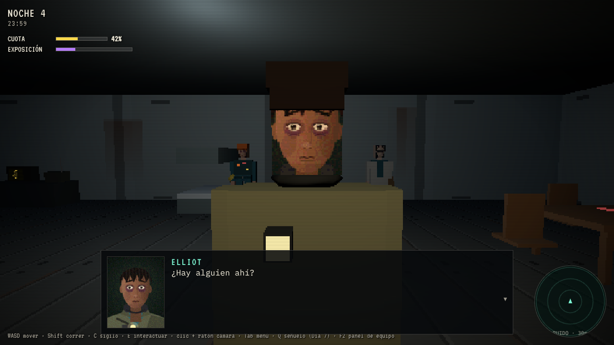

# PLOT ZERO · Cultivo Cero

> *Tres pasantes de Arcadia Eden Corp. cultivan una planta luminosa durante siete días en un planeta oscuro, guiados por PIP, la simpática mascota de la empresa. Cada noche, algo camina entre los cultivos. Uno de los tres empieza a notar que el cielo tiene costuras, que la mascota miente… y que alguien, al otro lado de la pantalla, le mueve las manos.*

Terror co-op de 1 a 3 jugadores: granja de día, supervivencia de noche y una cuarta pared que te mira de vuelta. Lanzamiento previsto en **Roblox** y después una edición ampliada en **Steam**.



## Qué hay en este repositorio

| Ruta | Contenido |
|---|---|
| [`docs/01-analisis/analisis-idea-y-mercado.md`](docs/01-analisis/analisis-idea-y-mercado.md) | Análisis de la idea, huecos de trama y sus soluciones, mercado Roblox frente a Steam, probabilidad de éxito y modelo de ingresos |
| [`docs/02-diseno/biblia-del-juego.md`](docs/02-diseno/biblia-del-juego.md) | Biblia del juego: estilo de personajes (inspirado en *Mouthwashing*), escenarios, los 7 días con diálogos, eventos y tareas, finales, sonido, cuarta pared y galería de capturas |
| [`docs/03-arquitectura/arquitectura-tecnica.md`](docs/03-arquitectura/arquitectura-tecnica.md) | Arquitectura DDD + hexagonal, Roblox (Rojo/Luau), Steam (Godot + P2P con Steam Networking Sockets), backend, CI/CD, riesgos de migración y hoja de ruta |
| [`demo/`](demo/) | **Demo vertical jugable** en el navegador (Three.js, estética PS1): los momentos clave del Capítulo 1 |
| [`CONTRIBUTING.md`](CONTRIBUTING.md) | Flujo de ramas (GitFlow) y convenciones |

## Probar la demo
```bash
cd demo
```
```bash
python3 -m http.server 8080
```
Abre `http://localhost:8080`. Controles: WASD · Shift correr · C sigilo · E interactuar · ratón/flechas: cámara · Q señuelo · Tab pausa · F2 panel de equipo.

## Ramas
`main` (versiones publicadas) · `develop` (integración; todo el trabajo actual vive aquí) · `feature/*` · `release/*` · `hotfix/*`. Detalles en [`CONTRIBUTING.md`](CONTRIBUTING.md).

---
*Personajes, mundo y marcas de PLOT ZERO son originales del equipo ArcadiaDevs. Las referencias a otros juegos (Mouthwashing, 99 Nights in the Forest, Grow a Garden, etc.) se hacen solo con fines de análisis.*
