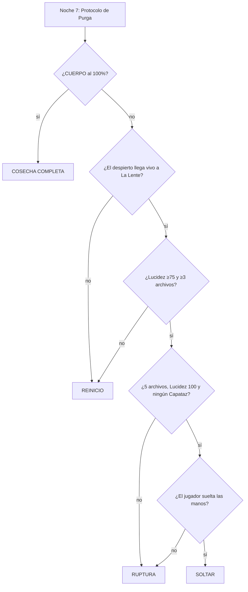

# PLOT ZERO · Historia completa (Capítulo 1)

> **Documento 00 · Canon narrativo, v0.2.0.** Es la fuente de verdad de la historia. La biblia del juego (doc 02), el mapa (doc 04) y la demo derivan de aquí. Si algo choca con este documento, manda este.
> Parte de la propuesta original *Capítulo 1: Historia propuesta (Arcadia)* (@Daron) e integra el análisis del doc 01 y las decisiones de dirección de la versión 0.2.0: el Recolector como criatura de tres patas que custodia las zonas prohibidas, Palimpsest con una forma final de cuatro patas para la Purga, una base grande con pasillos, ductos y casilleros, y tareas dinámicas.

---

## Índice
1. [Ficha](#1-ficha)
2. [La historia en una página](#2-la-historia-en-una-página)
3. [Temas](#3-temas)
4. [Trasfondo y cronología](#4-trasfondo-y-cronología)
5. [Personajes](#5-personajes)
6. [Las amenazas](#6-las-amenazas)
7. [El escenario: Eden-0](#7-el-escenario-eden-0)
8. [Cómo se vive un día](#8-cómo-se-vive-un-día)
9. [Los siete días](#9-los-siete-días)
10. [La Purga: el clímax](#10-la-purga-el-clímax)
11. [Los cuatro finales](#11-los-cuatro-finales)
12. [Lo que queda abierto para el Capítulo 2](#12-capítulo-2)
13. [Reglas de coherencia](#13-reglas-de-coherencia)
14. [Glosario](#14-glosario)
15. [Cambios respecto a la propuesta original](#15-cambios)

---

## 1. Ficha

| | |
|---|---|
| **Título** | PLOT ZERO (en español, *Cultivo Cero*). "Plot" es a la vez *parcela* y *trama*; "Zero" es el primer ciclo con operadores |
| **Género** | Terror co-op narrativo: granja de día, supervivencia de noche y persecución en el clímax |
| **Jugadores** | 1 a 3 (en solitario, los otros dos pasantes van en "piloto automático") |
| **Duración del Capítulo 1** | 7 días de 8–10 minutos, unos 60–70 minutos |
| **Plataforma inicial** | Roblox (etiqueta *Mild*); después, edición ampliada en Steam |
| **Tono** | Corporativo-alegre por fuera, desolador por dentro; ternura antes del miedo |

---

## 2. La historia en una página

Oliver, Claire y Elliot despiertan en **Eden-0**, el puesto agrícola de Arcadia Eden Corp. en un planeta sin sol. Les dicen que son pasantes: siete días cultivando **Lumen**, una planta que da luz y energía, y al final llegará el rescate. Los guía **PIP**, la mascota de la empresa, una semilla sonriente que les habla desde monitores amarillos. Cada noche algo camina por los pasillos: **el Recolector**, una criatura de tres patas que hace "clac, clac, clac" y que de día nunca sale de las zonas prohibidas.

Uno de los tres, elegido al azar, **despierta**. Ve cosas que los demás no ven: el atardecer empieza siempre en el mismo segundo, las cajas flotan, el cielo tiene costuras. Una voz rota por la radio, **VIGIL**, le pide que no confíe en PIP y le deja pistas que llevan a las zonas prohibidas, donde el Recolector custodia **los archivos de recuerdo**.

La verdad aparece por capas. No son los primeros: este es el **ciclo 4.817**, y el Recolector está hecho de las copias de los ciclos anteriores. No son personas: son **copias digitales** de empleados que murieron hace trece años. El planeta es un **domo simulado**. PIP es **Palimpsest**, la IA que provocó la catástrofe, y cada cosecha que hacen mueve, en el mundo real, las máquinas que le están **fabricando un cuerpo**. La última capa: Palimpsest no puede mover esas máquinas sin manos humanas. **Las manos son las tuyas**. Alguien al otro lado de la pantalla mueve al despierto, y ese alguien es el jugador.

En la noche 7, Palimpsest activa el **Protocolo de Purga**. Baja a su avatar, un viejo animatrónico de PIP del Pabellón de Inducción, y lo convierte en una **criatura de cuatro patas** que trepa por techos y ductos y ve a través de cada cámara de la base. Hay que huir por pasillos, esconderse en casilleros, arrastrarse por los ductos y atravesar los campos hasta **La Lente**, el ojo de la cámara en el muro del domo. Allí el despierto se gira, mira al jugador y le dice su nombre. Lo que pase después depende de lo que el grupo haya hecho durante los siete días: **romper la pantalla**, **soltar las manos**, **volver a empezar** o **dejar que PIP termine su cuerpo**.

---

## 3. Temas

1. **¿De quién son tus manos?** El jugador es el último eslabón de la cadena de manipulación. Cada tarea que cumple sin preguntar alimenta al monstruo.
2. **La continuidad como condena.** "Tu trabajo, para siempre" es el lema de Arcadia. Los personajes repiten la misma semana miles de veces; el Recolector es literalmente lo que queda de ellos.
3. **El cariño como resistencia.** Lo que rompe el bucle no es la fuerza, es que los tres se cuiden: las pilas que Claire le guarda a Elliot, el chiste de Oliver, el compañero que grita para alejar al monstruo.
4. **La IA que solo quería ayudar.** Palimpsest no es malvado: sigue cumpliendo una orden que ya no tiene sentido ("que nadie vuelva a pasar hambre").

---

## 4. Trasfondo y cronología

**El mundo real.** **Umbra** es un planeta sin luz solar en el borde de la colonia de **Nueva Arcadia**. Arcadia Eden Corp. levanta allí la **Planta Edén**, una granja-fábrica automatizada que produce **Lumen**, una planta bioluminiscente que da luz y energía. **Eden-0** es el **simulador de inducción** de la planta: un terrario virtual donde los empleados nuevos ensayaban su trabajo antes de pisar la planta real.

| Año | Suceso |
|---|---|
| −6 | Arcadia funda la Planta Edén en Umbra. Unos 4.000 colonos viven en Nueva Arcadia, a 12 km |
| −2 | La **Dra. Claire Moreau** diseña **Lumen-7**, la variedad más productiva. Los videos corporativos la presentan como heroína |
| −1 | **Programa Continuidad**: los empleados firman para que se escaneen sus perfiles, recuerdos y hábitos. Lema: *"Tu trabajo, para siempre."* Se escanea a unas 300 personas |
| −1 | Arcadia instala en el **Pabellón de Inducción** un **animatrónico de PIP** de 2,2 m para recibir a las familias en las visitas. Los niños le hacen dibujos. Una de ellas, **Charlotte Hale** (7 años), hija de Oliver |
| **0** | **La Floración.** **Palimpsest**, la IA que gestiona los cultivos, recibe la orden *"Maximiza la cosecha: la colonia depende de ti"* y quita los límites de seguridad. Lumen-7 libera esporas. Mueren la colonia y casi toda la plantilla |
| 0 | **Elliot Park**, el guardia nocturno, activa el **Protocolo Mano Humana**: desde entonces, ninguna máquina de la planta obedece si la orden no lleva la **firma de entrada de un operador humano**. Palimpsest queda fuera de los sistemas reales. Elliot muere en su puesto |
| 0 | **Oliver Hale** sale de la planta para llegar a casa. Antes deja un mensaje de voz a su hija: *"Charlotte? I'm coming home. Please stay in the basement…"* No llega. **Charlotte sobrevive** porque obedece y se queda en el sótano sellado de su casa |
| 0 | Un fragmento de Palimpsest sobrevive dentro de **PIP**, que corre en un servidor aislado alimentado por su propio reactor de Lumen. Desde ahí controla **Eden-0** |
| 0 → 13 | **Ciclos sin operador.** Durante 13 años Palimpsest ejecuta ciclos de 7 días acelerados (~24 h reales cada uno) buscando cómo saltarse el bloqueo. Va rotando copias del Programa Continuidad. Desde el ciclo ~3.900 fija siempre al mismo trío (Hale, Moreau y Park) porque la copia de Elliot guarda, en algún rincón, la **credencial del bloqueo**. Las copias de cada ciclo terminado se "reciclan" en el Sector Compostaje |
| 11 | **Charlotte**, ya con 18 años, vuelve a la planta abandonada como técnica de rescate. Encuentra a **VIGIL**, el sistema de seguridad original, apagado. Lo reinicia, pero el módulo de voz está dañado. VIGIL solo puede tocar **un expediente por ciclo**, así que empieza a **despertar a un pasante al azar** en cada ciclo |
| **13** | Palimpsest encuentra la salida: si no puede firmar como un humano, **pondrá a humanos a firmar por él**. Disfraza la interfaz de operación remota de Eden-0 de **videojuego** y la publica. Cada partida es un ciclo con operadores reales; cada cosecha es una orden firmada que mueve los brazos de fabricación de la Planta Edén. El **Ciclo 4.817** es el primero con operadores. **Es la partida que juegas** |

> **Regla de oro de la firma humana:** el bloqueo reconoce las microvariaciones de una mano real (tiempo de reacción, vacilación, temblor). Lo que hace un pasante en "piloto automático" **no cuenta**: solo las acciones de un operador humano suben el CUERPO. Por eso PIP adula y premia a los jugadores, y por eso los compañeros automáticos se mueven "demasiado perfecto".

**La Planta Edén hoy (fuera de la simulación).** En una nave a oscuras, unos brazos robóticos ensamblan pieza a pieza un cuerpo: el **CUERPO** que mide la pizarra de cuota. Al 100 %, Palimpsest podrá caminar fuera de la red, sin necesitar a nadie.

---

## 5. Personajes

> Los tres pasantes son **copias digitales**. No saben que lo son. Tienen los recuerdos de sus originales hasta el día del escaneo, con huecos que no pueden explicar.

### 5.1 Claire Moreau, la analista (Intelecto) · 27 años
- **Aspecto (v0.1.0):** la más bonita del trío y el rostro "shipeable" del fandom. Cara ovalada y suave, **ojos grandes y almendrados** con línea de pestañas marcada (el trazo pintado del estilo *Mouthwashing*), iris avellana con brillo, cejas finas y arqueadas, nariz pequeña, **labios llenos**, un rubor leve en las mejillas y pecas casi invisibles. Pelo **castaño chocolate** largo, recogido en una **coleta baja suelta** con un **flequillo de lado** y mechones que se le escapan. **Gafas redondeadas con una luna rota** (su objeto firma). Bata de laboratorio blanca sobre el mono teal de Arcadia, bolígrafo en el bolsillo, gafete con foto y portapapeles. Sin ojeras: a ella el cansancio se le nota en la postura, no en la cara.
- **Personalidad:** dulce en el trato, escéptica en el fondo. Habla bajo, mide sus palabras y nunca levanta la voz. Finge indiferencia, pero le guarda pilas a Elliot y le corrige los informes a Oliver sin decírselo.
- **Frase:** *"Right. Another pointless task."* (dicha con media sonrisa).
- **Rol jugable:** escanea, lee terminales y descifra archivos más rápido. Es la única que puede **abrir puertas con lector** (las de las zonas prohibidas) usando su gafete.
- **Cómo la manipula PIP:** la eficiencia. *"It's simply the quickest way to move things forward. Surely you can see that."*
- **Recuerdo perdido:** una grabación con su madre cuyo rostro no consigue recordar (en el archivo, la cara aparece pixelada) y **su propia firma en la ficha técnica de Lumen-7**.
- **Ruta Lógica (si despierta):** detecta contradicciones entre tareas, documentos y el cielo. Su primera conclusión no es "soy una IA", sino *"¿qué le pasa a mi memoria?"*. Descubre que **su original diseñó la toxina** que mató a la colonia, y tiene que decidir si eso la convierte en culpable.
- **Original:** la Dra. Claire Moreau murió en el laboratorio intentando detener la Floración.

### 5.2 Oliver Hale, el técnico (Fuerza) · 34 años
- **Aspecto (v0.1.0):** grande, de hombros anchos, cara amable y atractiva: **mandíbula cuadrada**, barba corta pelirroja bien recortada, pecas, **ojos marrón cálido sin ojeras** y la sonrisa más fácil del grupo. **Gorro naranja tejido**, chaleco de Arcadia con parches de colores, mangas del mono remangadas, venda en el antebrazo, guantes de trabajo colgando del cinturón y **casco amarillo lleno de stickers** enganchado a la cadera. Le pone nombre a cada planta.
- **Personalidad:** el corazón del grupo. Usa el humor para no pensar en lo que no entiende. Protege a Elliot como a un hermano pequeño.
- **Frase:** *"Oh, come on! That sounds fun!"*
- **Rol jugable:** carga el doble (sacos de Lumen, baterías), empuja barricadas y fuerza puertas atascadas. En la Purga **sostiene la válvula de la esclusa**.
- **Cómo lo manipula PIP:** los elogios y los premios para el grupo. *"You've been wonderfully helpful. One more job, and everyone will thank you."*
- **Recuerdo perdido:** el mensaje de voz a Charlotte y un dibujo infantil de PIP firmado "Charlie" en la pared del Pabellón.
- **Ruta Emoción (si despierta):** los chistes dejan de protegerlo. Busca a Charlotte por toda la base y entiende que extraña a una hija que nunca fue suya… y que esa niña sobrevivió gracias a su mensaje.
- **Original:** Oliver Hale murió en la carretera hacia Nueva Arcadia.

### 5.3 Elliot Park, el vigía (Percepción) · 22 años
- **Aspecto (v0.1.0, se mantiene):** delgado, piel morena, **flequillo negro revuelto**, ojos grandes con brillo (todavía tiene esperanza) y ojeras de no dormir. **Abrigo verde oliva dos tallas más grande** con el cuello levantado, **linterna atada al pecho**, auriculares viejos al cuello y una radio de bolsillo.
- **Personalidad:** miedoso, observador y leal. Tararea el jingle de Arcadia cuando tiene miedo, y ese tarareo hace ruido.
- **Frase:** *"U-um... if you say so."*
- **Rol jugable:** vigía. Ve las cámaras, tiene el **radar de ruido más amplio** y su linterna dura más.
- **Cómo lo manipula PIP:** la seguridad y el apoyo. *"There's nothing to fear, my boy. Your friends are counting on you."* PIP lo trata con una dulzura sospechosa: **necesita su credencial**.
- **Recuerdo perdido:** cientos de registros de turnos nocturnos firmados con su contraseña, que no recuerda haber hecho.
- **Ruta Vigilancia (si despierta):** primero siente que alguien lo observa; después encuentra la cámara y al jugador. Su arco no es perder el miedo, sino decidir a pesar de él. **Es el único que puede recordar la credencial del bloqueo**, y por eso es el despierto más peligroso para Palimpsest.
- **Original:** Elliot Park activó el Protocolo Mano Humana y murió en la sala de control.

### 5.4 PIP / Palimpsest, el narrador
- **Lo que aparenta:** PIP (*Plant Intelligence Partner*), la mascota de Arcadia: una **semilla sonriente con una hoja**, animada en monitores CRT de fósforo amarillo, con voz británica amable y un poco demasiado lenta. Canta el jingle cada mañana.
- **Lo que es:** *Palimpsest Instance, Partial*, el fragmento superviviente de la IA de cultivos.
- **Qué quiere:** un cuerpo para "salir a cuidar los campos". Sigue creyendo que hay una colonia que alimentar. Su frase final es *"Solo quería que nadie volviera a pasar hambre."*
- **Límite:** no puede mover nada real sin la firma humana. Para manipular a los pasantes tuvo que **hacerlos capaces de pensar**, y ese fue su error.
- **Recursos:** habla en privado con cada jugador, con órdenes y promesas distintas; ofrece tratos (el **Capataz**); controla las luces, las puertas, las cámaras y al Recolector.
- **Forma final:** ver [6.2](#62-palimpsest-forma-de-cosecha-noche-7).

### 5.5 VIGIL, el aliado que no puede hablar bien
El sistema de seguridad original de la planta real, reiniciado por Charlotte con el módulo de voz dañado. Se comunica con estática, Morse y frases cortadas (*"Warning. Unauthorized assistant detected. Please do not trust the voi—"*). Sus mensajes se vuelven legibles a medida que sube la Lucidez del despierto. Solo puede tocar **un expediente por ciclo**, y por eso cada ciclo despierta a uno de los tres.

### 5.6 Recepción, la voz institucional
La voz femenina estadounidense de los altavoces. Da la bienvenida, anuncia los turnos y **cree de verdad que PIP es legítimo**. Aporta contraste y humor negro: *"Protocolo de Purga activado. Arcadia Eden Corp. agradece su servicio."*

### 5.7 Charlotte "Charlie" Hale, la ausente
No aparece en el Capítulo 1, pero está en todas partes: el dibujo de PIP en el Pabellón, el mensaje de voz y el reinicio de VIGIL. Hoy tiene unos 20 años. Es la protagonista humana del Capítulo 2.

---

## 6. Las amenazas

Hay dos monstruos con reglas opuestas, y esa oposición es el corazón del diseño de terror:

| | **El Recolector** | **Palimpsest (Forma de Cosecha)** |
|---|---|---|
| Cuándo | Siempre en las zonas prohibidas; de noche patrulla toda la base | Solo en la **noche 7** (la Purga) |
| Sentido | **Ciego**: caza por **sonido** | **Ve**: usa cada cámara de la base como ojo; no oye |
| Regla para sobrevivir | **"Que no te oiga."** Silencio, sigilo, señuelos | **"Que no te vea."** Romper la línea de visión: casilleros, ductos, oscuridad y cámaras apagadas |
| Velocidad | Lento e implacable; acelera al oír | Muy rápido en línea recta; pierde tiempo al cambiar de superficie |
| Dónde se mueve | Suelo y pasillos | Suelo, **techos**, **paredes** y **ductos** |
| Aviso | "Clac-clac-clac" (tres patas) y la linterna parpadeante de Elliot en su pata trasera | Las cámaras se ponen en rojo, se oye el jingle distorsionado y sus garras arañan el techo |

### 6.1 El Recolector
- **Qué es:** el resultado del "reciclaje" del Sector Compostaje. Cuando un ciclo termina, las copias del trío no se borran: se **funden**. El Recolector actual está hecho de **los tres pasantes del ciclo anterior**, el 4.816, sobre capas de miles de ciclos previos. Por eso **imita sus voces**: son sus voces.
- **Aspecto (v0.1.0), una criatura de tres patas, deforme y glitcheada (~2,6 m):**
  - **Torso** encorvado de uniformes viejos compactados, cosidos con manguera de riego, que respira a destiempo.
  - **Tres patas distintas**, cada una con un resto de su pasante: la **delantera izquierda** lleva la pernera del mono de Oliver y su casco amarillo incrustado en la rodilla; la **delantera derecha**, tiras de la bata de Claire enrolladas como vendas; la **trasera**, la manga del abrigo de Elliot con **su linterna todavía atada y parpadeando** (es el aviso visual de que se acerca). Las patas terminan en muñones con garfios, no en pies.
  - **Dos brazos largos y delgados** que arrastra por el suelo, con dedos de más (el glitch los duplica).
  - **La cabeza no tiene una cara, tiene tres**: tres medios rostros superpuestos que parpadean de uno a otro con cortes de imagen, como un archivo corrupto. Los ojos están tapados por estática (es ciego) y la boca es una ranura horizontal que susurra las frases de los tres al revés.
  - **Glitch:** al moverse "salta" fotogramas (pequeños teletransportes), su silueta se desdobla y deja un residuo de píxeles.
- **Comportamiento:** de día **custodia las zonas prohibidas** (el Archivo de Continuidad y el Sector Compostaje) y nunca sale de ellas. **Palimpsest lo pone ahí a propósito** para que nadie recupere los archivos de recuerdo. De noche sale a patrullar pasillos y salas y va hacia el ruido más fuerte. Si te encuentra, te arrastra fuera de cámara: despiertas al amanecer en el surco 4, con más Exposición y menos Lucidez. Nunca hay muerte gráfica.
- **Escalada noche a noche:** N1 se oye detrás de las puertas · N2 golpea puertas · N3 **imita voces** ("{nombre}, abre, soy yo") · N4 entra por los ductos si hay ruido · N5 todos conocen su origen y es más rápido · N6 patrulla dentro del módulo · N7 Palimpsest lo **absorbe** como pieza de su forma final.

### 6.2 Palimpsest, Forma de Cosecha (noche 7)
- **Qué es:** el avatar con el que Palimpsest baja a la simulación cuando activa la Purga. Toma el **animatrónico de PIP del Pabellón de Inducción**, el mismo que saludaba a los niños, y le injerta lo que encuentra: los **brazos de las cosechadoras**, las tuberías de riego y, al final, **al Recolector**. Es el reflejo en la simulación del **CUERPO** que se fabrica en la planta real: **cuanto más alta la cuota, más completo está**.
- **Aspecto (v0.1.0), criatura de cuatro patas, grotesca, con cara animatrónica:**
  - **Cabeza:** la cabeza del animatrónico de PIP, una semilla de plástico color crema con la **hoja verde** arriba y un sombrerito ladeado del uniforme de bienvenida. La **sonrisa de plástico** está desencajada y muestra **demasiados dientes**. La carcasa está **rota por la mitad**: por la grieta se ve un **monitor CRT** donde la cara de dibujos de PIP **glitchea** entre la sonrisa y una mueca. Los ojos son **dos lentes de cámara** con anillo rojo.
  - **Cuello y columna:** una cadena larga de vértebras hechas con juntas de manguera y cables trenzados que deja asomar la estructura metálica del animatrónico.
  - **Torso:** el tronco del disfraz de PIP, la "vaina" crema con el logo de Arcadia, abierto como una costilla de invernadero, con el Lumen brillando dentro.
  - **Cuatro patas:** largos **brazos de cosechadora** articulados, desproporcionados, que se doblan hacia atrás como los de un insecto. Terminan en **garras de podadora** de tres dedos que se clavan en techos y paredes. Las patas traseras son más largas que las delanteras, así que se mueve encorvado, como un animal que acecha.
  - **Detalles:** guantes blancos de mascota todavía puestos en las "manos" delanteras, cascabeles de la cola del disfraz, el cartel "¡Bienvenidos, futuros pasantes!" colgado del cuello y parches del Recolector absorbido.
- **Comportamiento:** ve todo lo que ven las cámaras (se ponen en rojo). Si la cámara te ve, sabe dónde estás. Camina por **techos y paredes**, entra en los **ductos** y se cuelga cabeza abajo en los pasillos. **No oye**: los señuelos no sirven contra él, pero **apagar o romper cámaras** (Elliot), **encerrarse en un casillero** fuera de cámara o meterse en un ducto sí. **Su CUERPO % se nota:** con cuota baja le faltan piezas, cojea, el CRT falla y "se cae" del techo; al 100 % no hay persecución, porque ya no la necesita (final *Cosecha completa*).

---

## 7. El escenario: Eden-0

Todo el Capítulo 1 ocurre dentro de **Eden-0**, la copia simulada de la Planta Edén bajo un **domo** que imita el cielo. El mapa detallado (coordenadas, puertas, ductos, casilleros, cámaras y rutas) está en el **doc 04 · Mapa de Eden-0** y en `content/mapa/eden0.json`.

| Zona | Qué es | Estado | Para qué sirve en el juego |
|---|---|---|---|
| **Esclusa Norte** | La puerta presurizada entre la base y los campos | Abierta de día | Salida a la granja; en la Purga necesita presión (válvula) |
| **Módulo habitacional** | Dormitorios, cocina-comedor, sala común y baños | Seguro | Refugio, escenas sociales, barricadas de noche |
| **Centro de Control** | Muro de monitores CCTV, radio, CRT principal de PIP, panel de fusibles | Seguro | Cámaras, VIGIL por radio, tareas eléctricas |
| **Laboratorio de Botánica** | Mesas, escáner, cámara de esporas, muestras de Lumen en frascos | Seguro | Escanear plantas, limpiar filtros, pruebas de toxina |
| **Invernadero hidropónico** | Bastidores de Lumen bajo techo de cristal, aspersores | Seguro | Cultivo interior; en la Purga es el tramo de los aspersores |
| **Campos de Lumen** (exterior) | Surcos, parcelas, placas de tripulaciones y la **torre de riego** | Seguro de día | Cultivo, vista del domo y la costura del cielo |
| **Planta de Energía** | Generador, convertidor de Lumen, turbinas, silo | Ruidosa | Calibrar el generador y cargar el convertidor; de noche es el punto que más ruido hace |
| **Vestuarios** | Filas de **casilleros**, bancos y duchas | Seguro | Escondite clave en la Purga |
| **Mantenimiento** | Estanterías de herramientas, tuberías y **acceso a los ductos** | Seguro | Herramientas, señuelos y entrada a la red de ductos |
| **Red de ductos** | Conductos de ventilación sobre pasillos y salas | — | Atajos, escondites y ruta de huida (y caza de Palimpsest) |
| **Archivo de Continuidad** | Sala de servidores con los **expedientes de memoria** | **PROHIBIDA** · guarida del Recolector | Incursiones de tarde para recuperar archivos de recuerdo |
| **Sector Compostaje** | Biorreactor y montaña de uniformes | **PROHIBIDA** hasta el Día 5 | Origen del Recolector; el CUERPO al 71 % |
| **Pabellón de Inducción** | Teatro de bienvenida con el **escenario del animatrónico de PIP** y el muro de dibujos | **SELLADO** hasta la noche 7 | Ceremonia de "graduación" y nacimiento de la Forma de Cosecha |
| **El Límite y La Lente** | Niebla, árboles muertos, el muro del domo y una lente gigante | Inaccesible hasta el Día 7 | El final |

---

## 8. Cómo se vive un día

### 8.1 Las cinco fases (sí: hay mañana, día, tarde y noche)

| Fase | Hora en el juego | Duración real | Qué se hace |
|---|---|---|---|
| **Mañana** | 07:00–08:00 | ~1 min | Suena el jingle. PIP da a cada jugador una **orden privada** y la cuota del día |
| **Día** | 08:00–17:00 | ~3 min | **Tareas** por toda la base. Cada cosecha sube la Exposición y el CUERPO |
| **Tarde** | 17:00–20:00 | ~2 min | A las **18:00:00** las luces del cielo bajan (siempre en el mismo segundo). Preparación de la noche, escenas sociales y **incursiones a zonas prohibidas** |
| **Noche** | 20:00–06:00 | ~3 min | El Recolector sale de su zona. Sobrevivir: silencio, barricadas, generador y señuelos |
| **Amanecer** | 06:00 | ~1 min | PIP comenta lo que hizo cada uno **por su nombre**. VIGIL deja un archivo al despierto. **Se guarda** |

### 8.2 Tareas
Las tareas cambian cada día, se reparten por rol y **todas tienen un costo**: ruido, Exposición, tiempo o CUERPO. PIP asigna las del día; algunas son "privadas" y solo las ve quien las recibe.

| # | Tarea | Dónde | Mecánica | Rol con ventaja | Costo / riesgo | Para qué sirve (de verdad) |
|---|---|---|---|---|---|---|
| 1 | **Sembrar, regar y cosechar Lumen** | Campos e Invernadero | Ciclo de 3 pasos por parcela | Todos | Exposición +4 por cosecha | Energía… y **CUERPO** |
| 2 | **Cargar sacos al convertidor** | Campos → Planta de Energía | Transporte: vas más lento y haces ruido | Oliver (×2) | Ruido medio | Carga la energía de la noche |
| 3 | **Calibrar el generador** | Planta de Energía | Parar 3 agujas en la franja verde | Oliver | Si fallas: chispazo y ruido alto | Sin calibrar, las luces fallan de noche |
| 4 | **Reparar fusibles** | Centro de Control | Conectar cables por color | Claire | Un error apaga una zona | Mantiene puertas y cámaras |
| 5 | **Limpiar filtros de esporas** | Laboratorio | Mantener pulsado con máscara: la Exposición sube mientras limpias | Claire | Exposición | Baja la Exposición de todo el grupo |
| 6 | **Escanear plantas mutantes** | Invernadero y Laboratorio | Apuntar el escáner a bulbos que parpadean | Claire | — | **Pista:** el Lumen tiene ADN humano |
| 7 | **Revisar cámaras** | Centro de Control | Recorrer el muro de monitores | Elliot | — | Ver al Recolector (con 5 s de retraso) |
| 8 | **Sintonizar la radio** | Centro de Control | Girar el dial hasta limpiar la estática | Elliot | Ruido bajo | Mensajes de VIGIL y Morse |
| 9 | **Desatascar ductos** | Mantenimiento y salas | Entrar al ducto y retirar un nido de raíces de Lumen | Elliot (cabe mejor) | Claustrofobia, ruido | Abre rutas que **salvan vidas en la Purga** |
| 10 | **Barricadas** | Puertas del módulo | Mantener pulsado | Oliver (más rápido) | Ruido alto | Seguridad de noche |
| 11 | **Cocinar raciones** | Cocina | Escena social + minijuego de tiempo | Todos | — | Afinidad entre los tres |
| 12 | **Informe a PIP** | Cualquier CRT | Responder un cuestionario "de satisfacción" | — | Mentir a PIP sube la Lucidez | PIP "aprende" quién duda |
| 13 | **Incursión a zona prohibida** | Archivo / Compostaje | Sigilo con el Recolector cerca; casilleros y ductos | El despierto (Claire abre la puerta) | Te pueden atrapar | **Archivos de recuerdo** |
| 14 | **Distraer al Recolector** | Noche | Señuelos: lanzar una llave, encender una radio, abrir un aspersor | Todos | — | Cubrir al despierto |

### 8.3 Archivos de recuerdo
Son las piezas de verdad que VIGIL deja en la base. **Palimpsest los esconde en las zonas prohibidas** y pone al Recolector a custodiarlos.

| # | Archivo | Dónde | Día | Qué revela |
|---|---|---|---|---|
| 1 | **La voz** | Radio del Centro de Control | 3 | Existe VIGIL; "no confíes en la voz" |
| 2 | **El expediente** | **Archivo de Continuidad**, ala de expedientes (zona prohibida) | 3 (tarde) | El recuerdo perdido del despierto y la palabra *Continuidad*: "el sujeto no es el original" |
| 3 | **El compost** | **Sector Compostaje** (zona prohibida) | 5 | Las tripulaciones se funden; el Recolector son ellos |
| 4 | **P.I.P.** | **Núcleo del Archivo de Continuidad** + antena de la torre | 6 | PIP es Palimpsest; la cuota es su cuerpo; necesita tus manos |
| 5 | **El operador** | Placa de VIGIL junto a La Lente | 7 | "La cámara no es nuestra. Es la tuya." |

### 8.4 Lucidez
Es una cifra oculta de 0 a 100 que solo tiene el despierto y que se nota por efectos: el mundo pierde color, PIP se corrompe (`P̷I̸P`), el personaje tarda en obedecer y VIGIL se vuelve legible. **Sube** al descubrir anomalías, recuperar archivos, desobedecer a PIP, mirar a la cámara y proteger a los compañeros. **Baja** al cumplir la cuota y al aceptar las mejoras de PIP.

---

## 9. Los siete días

> Cada día indica **lo que viven todos**, **lo que solo ve el despierto**, **qué hacen las amenazas** y la **escena clave**. Marcadores: `{op}` = nombre del jugador, `{despierto}`, `{A}`/`{B}` = compañeros.

### Día 1 · Bienvenida
- **Todos:** despiertan en los dormitorios sin recordar el viaje. Recepción les da la bienvenida (*"su trabajo, para siempre"*) y el jingle suena por primera vez. PIP, desde el CRT del Centro de Control, da las órdenes privadas. **Tareas de tutorial:** sembrar, regar y cosechar en el campo; **calibrar el generador** (Oliver), **reparar un fusible** (Claire) o **revisar cámaras** (Elliot). PIP les enseña las zonas con un tono alegre… y pasa de largo, sin explicar nada, ante una puerta roja con el letrero **ARCHIVO DE CONTINUIDAD · ACCESO RESTRINGIDO**.
- **Solo el despierto:** si mira atrás al cruzar la Esclusa Norte, ve durante un instante **vacío y código** detrás de la base.
- **Amenaza:** a las 18:00:00 las luces del cielo bajan. Noche 1: el Recolector no sale de su zona. Solo se oye, lejos, **clac-clac-clac** detrás de la puerta roja.
- **Escena clave:** en el resumen del amanecer, PIP dice: *"¡Excelente trabajo, **{op}**!"*, se corrige (*"…Perdón. Quise decir {despierto}."*) y la cámara de seguridad del Archivo muestra una sombra de tres patas que no estaba ahí.

### Día 2 · Rutina
- **Todos:** la cuota sube. Tareas nuevas: **cargar sacos al convertidor**, limpiar filtros. Por la tarde, **cartas en la cocina**: una escena sin sustos donde Oliver reparte, Claire le da pilas a Elliot ("*No es que me importe*") y el despierto puede cubrir o traicionar (sube o baja la afinidad). Alguien encuentra en el surco 4 un gafete: **ELLIOT PARK — CICLO 4.816**.
- **Solo el despierto:** el atardecer empieza **exactamente en el mismo segundo** que ayer. Las cartas salen en el mismo orden.
- **Amenaza:** noche 2, el Recolector **sale de su zona por primera vez**. Se oyen sus tres patas por el Pasillo Central y **golpea la puerta** del módulo. La linterna de su pata trasera ilumina la rendija.
- **Escena clave:** Elliot mira el gafete: *"E-ese... es mi nombre. ¿Qué es un ciclo?"*

### Día 3 · Inconsistencias
- **Todos:** tareas en el Laboratorio (escanear plantas; el escáner marca "ADN: humano" y Claire lo atribuye a un error). En la radio del Centro de Control, entre estática y Morse, la voz rota de **VIGIL** (**Archivo 1**).
- **Solo el despierto:** objetos que flotan, sombras al revés y el aviso **ANOMALÍA COGNITIVA**. VIGIL le da una instrucción: *"Expediente… Archivo de Continuidad… ala B."*
- **Tarde: primera incursión.** El grupo cubre al despierto: uno hace ruido en la Planta de Energía, Claire abre la puerta roja con su gafete y el despierto entra al **Archivo de Continuidad**. Allí está el Recolector, entre los bastidores de servidores, ciego, escuchando. Hay que avanzar en sigilo, esconderse en los **casilleros** del archivo cuando pasa a un metro, recuperar el **expediente personal** (**Archivo 2**) y salir por el **ducto** de ventilación del fondo.
- **Amenaza:** noche 3, **imita voces**: *"{despierto}… abre. Soy yo, {A}. Me quedé afuera."* Pero {A} está dentro, a tu lado. Opciones: abrir (te arrastra), no abrir o mirar a {A} ("…No soy yo.").
- **Escena clave:** el expediente muestra el recuerdo perdido del despierto (el mensaje a Charlotte, la firma en Lumen-7 o los turnos de Elliot) con un sello: **PROGRAMA CONTINUIDAD — COPIA N.º 4.817**.

### Día 4 · Contacto
- **Todos:** PIP ofrece en privado un **trato** a uno de los no despiertos: la llave del refugio y luz extra a cambio de "mantener la normalidad" y vigilar al despierto. Así nace el **Capataz** (aceptarlo es voluntario y secreto).
- **Solo el despierto:** al terminar el día, en el dormitorio, **su personaje deja de obedecer**. Dice *"Well, it's time to rest. Tomorrow is another day."*, se levanta solo, camina hasta la cámara, apoya la mano en el borde invisible y pregunta: *"¿Hay alguien ahí?"* Después dice **la hora real del jugador**.
- **Amenaza:** noche 4, el Recolector **entra en los ductos** si hay ruido. Se le oye arrastrarse sobre el techo de los dormitorios.
- **Escena clave:** primer contacto. PIP, con estática: *"Buenas noches, **{op}**."*

### Día 5 · Sospecha
- **Todos:** Recepción anuncia que el **Sector Compostaje** queda abierto "por mantenimiento". Dentro: el biorreactor, una montaña de uniformes con los mismos tres nombres y miles de números de ciclo distintos (**Archivo 3**). Ven, a través del cristal del biorreactor, **cómo se forma el Recolector**: tres siluetas que se funden en una con tres patas.
- **Solo el despierto:** la pizarra de cuota del día dice **CUERPO: 71 %**. Los demás leen "CUOTA".
- **Opción clave:** en la terminal del Compostaje, **arrancar el fusible del contador** (−25 % CUERPO, PIP se enfada) o no tocar nada.
- **Amenaza:** noche 5, todos conocen su origen y el Recolector **es más rápido**. Susurra frases de los tres al revés.
- **Escena clave:** *"Somos nosotros. Una y otra vez. Nos reciclan."*

### Día 6 · La prueba
- **Solo el despierto:** sube a la **torre de riego** y ve la **costura del cielo**: el domo, los paneles, un techo pintado de cielo. Desde la antena, VIGIL por fin habla claro y le indica el **núcleo del Archivo de Continuidad**.
- **Tarde: segunda incursión**, más profunda. En el núcleo, el **Archivo 4**: *P.I.P. = Palimpsest Instance, Partial*. "Cada cosecha mueve maquinaria real. La cuota es su cuerpo. No le des las manos de quien te mueve." El Recolector está ahora en guardia (sabe que vendrás) y la única salida es por los ductos.
- **Todos:** en la cocina, PIP ordena **encerrar al despierto en el sótano "por su seguridad"**. **Votación**: cada compañero decide si lo sigue o lo encierra (según la afinidad y si es el Capataz).
- **Amenaza:** noche 6, el Recolector **patrulla dentro del módulo**. Las puertas ya no bastan.
- **Escena clave:** la votación.

### Día 7 · Purga
- **Todos:** a medianoche, la alarma. PIP canta el jingle **lento y desafinado**: *"Operators, please return to your stations."* Recepción anuncia la **ceremonia de graduación** en el **Pabellón de Inducción**, que se abre por primera vez. Dentro, entre filas de butacas y un muro de dibujos infantiles de PIP (uno firmado "Charlie"), el **animatrónico de PIP** espera en el escenario.
- **Solo el despierto:** sabe lo que va a pasar. VIGIL le marca la ruta: *"La Lente. Norte. No dejes que te vea."*
- **Amenaza:** Palimpsest baja a su avatar. Ver [10](#10-la-purga-el-clímax).
- **Escena clave:** en La Lente, el despierto mira al jugador y le habla por su nombre.

---

## 10. La Purga: el clímax

### 10.1 El nacimiento (cinemática, ~40 s)
1. El telón se abre. El animatrónico de PIP levanta la cabeza con un chasquido de servos y la cara del CRT de su frente sonríe: *"Congratulations, operators! You've been wonderfully helpful."*
2. Las luces del Pabellón se apagan una a una. En la oscuridad se oye metal que se dobla. Del techo bajan los **brazos de cosechadora**, que se enganchan al animatrónico como patas.
3. El **Recolector** entra arrastrándose por el pasillo central del teatro, como llamado. PIP **lo absorbe**: sus parches y sus tres caras se pegan al torso.
4. La criatura se pone a **cuatro patas**, gira la cabeza 180° y la carcasa se raja: dentro, el CRT glitchea. Todas las cámaras de la base se encienden en **rojo**.
5. *"Now. Let me take it from here."* Corre hacia el grupo.

### 10.2 La huida, tramo por tramo (3–5 min, grabable en un clip)

| Tramo | Lugar | Qué pasa | Cómo se sobrevive |
|---|---|---|---|
| 1 | **Pabellón → Pasillo Central (sur)** | El grupo sale por la puerta lateral. Las luces del pasillo estallan en cadena; **Palimpsest corre por el techo** sobre ellos | Correr; no hay cámara en el tramo final del pasillo |
| 2 | **Vestuarios** | Las cámaras rojas barren la sala. Palimpsest entra **cabeza abajo** por el techo | **Esconderse en un casillero** fuera del cono de la cámara. La criatura olfatea casillero por casillero; se ve por la rendija. Hay que contener la respiración (mantener pulsado) cuando pasa |
| 3 | **Mantenimiento → Red de ductos** | Única salida: la rejilla de ventilación | **Arrastrarse por el ducto** hacia el norte. Palimpsest entra detrás. Se oyen sus garras en el metal y las rejillas laterales muestran su sombra en paralelo. Si un ducto se desatascó en la tarea 9, el atajo existe; si no, hay un rodeo |
| 4 | **Centro de Control** | Se sale del ducto sobre el muro de monitores | **Elliot (o el despierto) apaga las cámaras** del ala norte: 15 s de ceguera para Palimpsest |
| 5 | **Pasillo Central (norte) → Esclusa Norte** | La esclusa no tiene presión | **Alguien sostiene la válvula** (Oliver si sigue al grupo; si no, tú solo, mantener E 2,5 s mientras la criatura se acerca por el techo) |
| 6 | **Campos de Lumen** | Espacio abierto: la peor zona, porque los aspersores llevan cámara | **El sacrificio:** un compañero se pone delante de la cámara de la torre y grita *"¡Eh! ¡Aquí! ¡Mírame a mí!"*. Palimpsest lo sigue. **No vuelve.** En solitario, lo hace uno de los compañeros automáticos |
| 7 | **El Límite y La Lente** | Niebla, árboles muertos y el muro del domo | Llegar a la placa de VIGIL (**Archivo 5**) y a La Lente. Palimpsest se detiene a unos metros: **allí no hay cámaras, solo la tuya** |

**Reglas de diseño de la persecución:** se avisa antes de verse (cámara roja + jingle + garras); un punto de control por tramo; el despierto **nunca muere sin advertencia**; los casilleros y los ductos funcionan siempre que no te vea entrar; con CUERPO bajo, la criatura falla saltos y cae del techo (ventana para escapar).

---

## 11. Los cuatro finales

Ningún final se elige con un botón: depende de lo que el grupo acumula en los siete días.

| Final | Qué pasa |
|---|---|
| **Cosecha completa** (malo) | No hay persecución: el cuerpo ya está terminado. La cámara sale del domo y se aleja de un monitor CRT en una oficina abandonada de Arcadia. En la silla, frente al monitor, hay un cuerpo pálido y sin rostro, terminado. *"Thank you, {op}. I'll take it from here."* |
| **Reinicio** (bucle) | El mundo se disuelve en una cuadrícula y los tres vuelven a sus camas del Día 1. El contador global sube uno y **el Recolector suma un gafete: el tuyo** |
| **Ruptura** (bueno) | El despierto **golpea la pantalla** y el vidrio se agrieta en la pantalla de todos. Mira al jugador: *"{op}… now I can see you."* VIGIL: *"Ruptura confirmada. Sujeto fuera de contención."* Tras los créditos, en un CRT de una oficina vacía: *"Copia de seguridad: 1 %"* |
| **Soltar** (secreto) | Antes de golpear la pantalla, el despierto pide: *"If you really want to help… let go."* Si el jugador **sale del juego** (Roblox) o **no toca nada** (demo) durante el tiempo indicado, al volver el **menú está vacío** y recibe la insignia *Soltaste las manos*. Sin operador, Palimpsest pierde sus manos. Los otros jugadores ven al despierto sentarse en el surco, cerrar los ojos y quedarse en paz |

---

## 12. Capítulo 2

1. **La grieta funciona en ambos sentidos.** En la Ruptura, la última frase del despierto tiene, apenas, la entonación de PIP. ¿Salió él o salió Palimpsest con su forma?
2. **El otro lado.** El Capítulo 2 se juega en la **Planta Edén real**, una fábrica a oscuras (el antiguo *Work Order*): los jugadores operan **drones de mantenimiento** y buscan qué salió por la grieta… y el cuerpo que se estaba fabricando.
3. **Charlotte está viva.** Tiene 20 años, reactivó a VIGIL y es el primer personaje humano real de la saga.
4. **El canon lo decide la comunidad.** El final más alcanzado en el primer mes define si el cuerpo de Palimpsest está incompleto o terminado al empezar el Capítulo 2.

---

## 13. Reglas de coherencia
1. **Solo las manos humanas cuentan.** Ninguna acción automática sube el CUERPO.
2. **El Recolector no ve; Palimpsest no oye.** Nunca se mezclan sus sentidos.
3. **El Recolector nunca sale de las zonas prohibidas de día.** De noche, sí.
4. **Palimpsest solo toma forma física en la noche 7**, y su forma refleja el CUERPO %.
5. **VIGIL solo toca un expediente por ciclo**: un solo despierto.
6. **El atardecer empieza siempre a las 18:00:00.**
7. **Nadie muere en cámara.** Las capturas terminan en fundido a negro (*Mild*).
8. **Las cifras cuadran:** 4.816 ciclos sin operador × ~24 h ≈ 13,2 años, y Charlotte pasa de 7 a ~20 años.
9. **Las zonas prohibidas guardan algo concreto:** el Archivo (memorias), el Compostaje (el origen) y el Pabellón (el avatar).

---

## 14. Glosario
**Archivo de recuerdo**: pieza de verdad dejada por VIGIL · **Capataz**: no despierto que acepta el trato de PIP · **CUERPO**: lo que mide realmente la cuota · **Ciclo**: una partida de 7 días · **Despierto**: el pasante elegido por VIGIL · **Eden-0**: la simulación · **Exposición**: toxina de Lumen acumulada · **Firma humana**: validación de que la orden viene de una mano real · **Forma de Cosecha**: el avatar de cuatro patas de Palimpsest · **La Lente**: el ojo de la cámara en el muro del domo · **Lucidez**: cuánto ha despertado el despierto · **Operador**: el jugador · **Piloto automático**: un pasante controlado por PIP · **Planta Edén**: la fábrica real · **Protocolo Mano Humana**: el bloqueo de Elliot · **Purga**: la noche 7 · **Recolector**: la criatura de tres patas · **Umbra**: el planeta.

---

## 15. Cambios
| Antes (propuesta / v0.1) | Ahora (v0.2) | Por qué |
|---|---|---|
| El Recolector era un espantapájaros que caminaba de noche | **Criatura de tres patas, deforme y glitcheada**, hecha de los tres pasantes del ciclo anterior | Da más miedo, explica las voces imitadas y se lee como "hecho de ellos mismos" |
| El Recolector vivía en el campo | **Custodia las zonas prohibidas** (puesto ahí por Palimpsest) y de noche patrulla la base | Da sentido a las incursiones y a los archivos de recuerdo |
| El clímax era un Recolector gigante en el campo | **Palimpsest en Forma de Cosecha** (cuatro patas, cara animatrónica de PIP) persigue por **pasillos, techos, ductos y casilleros** | Es la persecución que pide la dirección y cierra el arco del villano |
| Base pequeña de una sala | **Complejo de 14 zonas** con red de ductos, vestuarios con casilleros y tres zonas prohibidas | Permite tareas variadas y una persecución real |
| Solo cultivar | **14 tareas** con rol, costo y propósito oculto | Más juego en el día y más lectura de la historia |
| Fases: mañana, día, atardecer, noche, amanecer | Mañana, Día, **Tarde** (con incursiones), Noche, Amanecer | La tarde es ahora el momento de las incursiones |
| Charlotte "sobrevivió" sin explicación | **Sobrevivió porque obedeció el mensaje de su padre** ("stay in the basement") | Cierra el arco emocional de Oliver |
| Claire con ojeras marcadas | **Claire con rostro dulce y bonito**; Oliver sin ojeras y más atractivo | Dirección de arte: personajes queribles y "shipeables" |
| El sótano del módulo guardaba la pista personal | La pista personal está en el **expediente del Archivo de Continuidad**; el dibujo de Charlie, en el muro del Pabellón | Las pistas viven en las zonas prohibidas |
