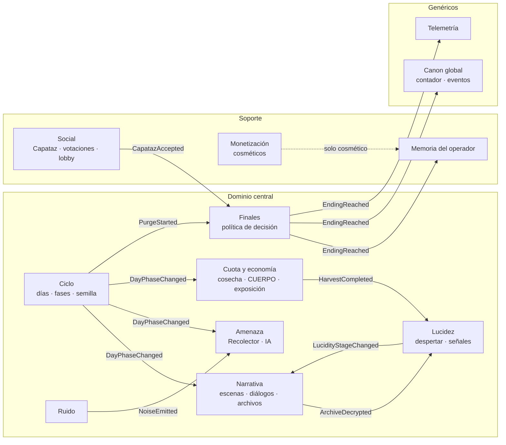
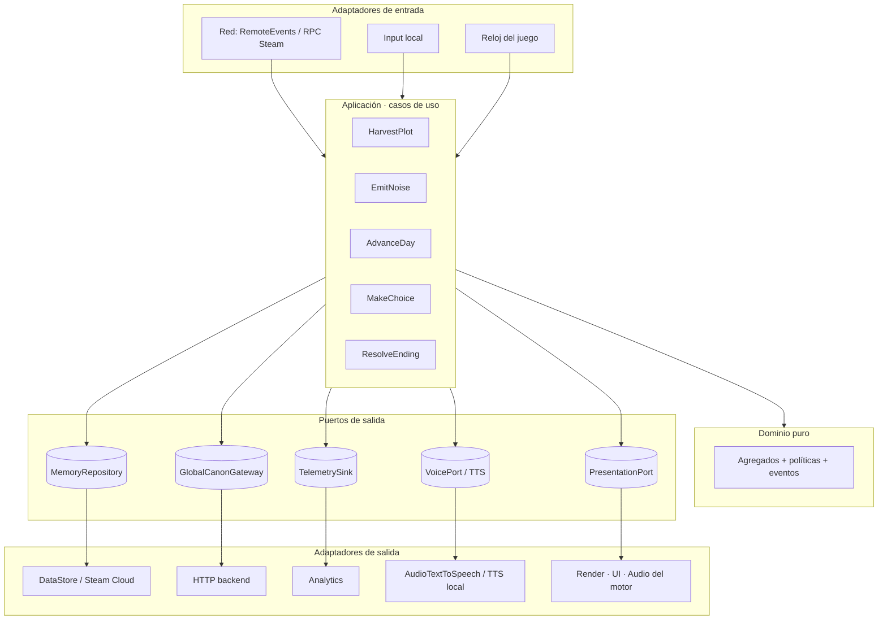
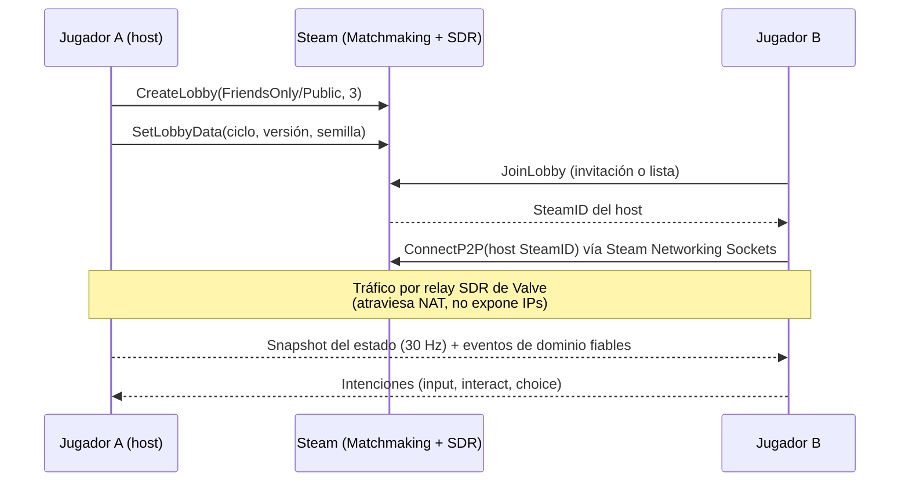
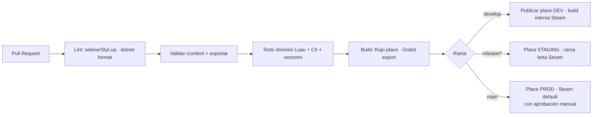

# PLOT ZERO: arquitectura técnica e infraestructura

> **Documento 03 · Arquitectura.** Cubre la plataforma, la arquitectura de software (DDD + hexagonal), la implementación en Roblox, la implementación futura en Steam (con multijugador P2P), el backend compartido, los pipelines, la calidad y el flujo de Git.
> Las decisiones se registran como **ADR** (*Architecture Decision Records*) para que el equipo pueda revisarlas.

## Índice
1. [Decisiones clave (ADR)](#1-decisiones-clave-adr)
2. [Principios](#2-principios)
3. [Dominio: bounded contexts y lenguaje ubicuo](#3-dominio)
4. [Arquitectura hexagonal (puertos y adaptadores)](#4-arquitectura-hexagonal)
5. [Implementación en Roblox (fase 1)](#5-roblox)
6. [Implementación en Steam (fase 2) y multijugador P2P](#6-steam)
7. [Backend compartido](#7-backend-compartido)
8. [Contenido como datos y pipelines](#8-contenido-como-datos)
9. [Calidad: pruebas, CI/CD y observabilidad](#9-calidad)
10. [Repositorio y flujo de Git](#10-repositorio-y-flujo-de-git)
11. [Riesgos de migrar de Roblox a Steam](#11-riesgos-de-migración)
12. [Hoja de ruta y equipo](#12-hoja-de-ruta)
13. [Cumplimiento de normas (checklist)](#13-cumplimiento)

---

## 1. Decisiones clave (ADR)

### ADR-001 · Roblox primero, Steam después como producto ampliado
- **Contexto:** equipo de 5, primer juego, sin comunidad; el formato co-op día/noche es nativo de Roblox. El análisis de mercado está en el doc 01, §5.
- **Decisión:** el Capítulo 1 sale **gratis en Roblox** con cosméticos. Steam llega después como ***PLOT ZERO: Expediente Completo*** (de pago) en un motor propio.
- **Consecuencias:** la lógica no se porta, se **reimplementa**. Por eso el dominio debe ser pequeño, puro y estar especificado con **vectores de prueba compartidos** (ADR-003).

### ADR-002 · DDD + arquitectura hexagonal
- **Decisión:** se modela el juego por **bounded contexts** (DDD, Evans) y cada uno se implementa como **hexágono** (Ports & Adapters, Cockburn). El dominio no conoce ni Roblox, ni Godot, ni la red, ni el render.
- **Por qué:** (1) permite probar la lógica narrativa sin motor (en CI, en segundos); (2) es lo que hace posible pasar a Steam; (3) cinco personas pueden trabajar en paralelo sin pisarse.
- **Matiz pragmático:** en el *game loop* caliente (movimiento, física, render) **no** se aplica DDD. Ahí manda el motor (o un ECS). DDD se usa donde están las reglas: ciclo, Lucidez, narrativa, cuota y finales.

### ADR-003 · Contenido como datos + especificación ejecutable
- **Decisión:** diálogos, escenas, balance, finales y localización viven en `/content` (YAML) y se validan con JSON Schema. Unos exportadores generan **módulos Luau** (Roblox) y **recursos C#/JSON** (Godot). Las reglas del dominio se acompañan de **vectores de prueba en JSON** (entrada → salida esperada) que ejecutan ambas implementaciones.
- **Consecuencia:** guionistas y diseñadores editan contenido sin tocar código, y la paridad entre plataformas se comprueba de forma automática.

### ADR-004 · Steam en Godot 4 (.NET/C#) con Steam Networking Sockets
- **Decisión:** Godot 4.x con C#, GodotSteam y `SteamMultiplayerPeer` (relay SDR de Valve), en una topología **host autoritativo** (*listen server*) para 1–3 jugadores.
- **Alternativa evaluada:** Unity 6 + Netcode for GameObjects o FishNet + Facepunch.Steamworks. Es viable y tiene más ecosistema, pero tiene costes de licencia y es más pesada. Ver la tabla en §6.1.

### ADR-005 · Backend serverless mínimo y propio
- **Decisión:** un backend pequeño (Cloudflare Workers + Durable Objects + D1, o el equivalente en AWS Lambda + DynamoDB) **solo** para lo que es global y compartido entre plataformas: **contador global de ciclos**, **canon comunitario**, **eventos en vivo y ARG** y **telemetría**. Las partidas viven en la plataforma (DataStore / Steam Cloud).

---

## 2. Principios
1. **Servidor autoritativo** para todo lo que afecte a otros jugadores o a la economía (cuota, finales, Capataz, compras). El cliente solo presenta.
2. **Lo que ve el despierto se dibuja solo en su cliente** (anomalías), pero **lo decide el servidor** (quién despierta y qué anomalía toca).
3. **Determinismo narrativo:** con la misma semilla de ciclo y las mismas acciones, el mismo resultado. Facilita depurar, los vectores de prueba y los puzzles por servidor.
4. **Eventos de dominio** como pegamento entre contextos (`HarvestCompleted` → Cuota, Lucidez y Telemetría), nunca llamadas cruzadas directas.
5. **Mobile-first** en Roblox: presupuesto de ~60 k triángulos en vista, ≤ 2 luces dinámicas y niebla obligatoria.
6. **Privacidad por diseño:** del micrófono solo viaja un número de volumen; nunca se pide ni se muestra un dato fuera del juego.

---

## 3. Dominio

### 3.1 Lenguaje ubicuo (glosario)
| Término | Significado |
|---|---|
| **Ciclo** | Una partida completa de 7 días. Tiene número global (4.817…) y semilla |
| **Día / Fase** | 1–7 / Mañana, Día, Atardecer, Noche, Amanecer |
| **Pasante** | Oliver, Claire o Elliot (personaje controlable) |
| **Operador** | El jugador humano que controla a un pasante |
| **Despierto** | El pasante elegido por VIGIL en este ciclo |
| **Piloto automático** | Pasante controlado por PIP (en solitario o si alguien sale) |
| **Lucidez** | 0–100, oculta, por despierto |
| **Archivo VIGIL** | Pieza de verdad descifrada (v1–v5) |
| **Cuota / CUERPO** | El mismo valor; "CUERPO" es como lo ve el despierto desde el Día 5 |
| **Exposición** | Toxina acumulada por pasante |
| **Ruido** | Evento con posición, intensidad y origen |
| **Capataz** | No despierto que aceptó el trato secreto de PIP |
| **Firma humana** | Validación de que una acción viene de un operador humano |
| **Final** | Cosecha completa, Reinicio, Ruptura o Soltar |
| **Memoria del operador** | Lo que persiste entre ciclos (gafetes, finales, el gafete en el Recolector) |

### 3.2 Mapa de contextos

Relaciones: **Finales** es *conformist* de Lucidez, Cuota y Social (lee sus estados). **Canon global** es un *Open Host Service* (API pública del backend). **Monetización** está aislada con una *anticorruption layer* (no puede tocar supervivencia, y eso se garantiza con una prueba).

### 3.3 Agregados, invariantes y eventos
| Contexto | Agregado raíz | Invariantes | Eventos que emite |
|---|---|---|---|
| Ciclo | `Cycle` | Las fases avanzan en orden; el atardecer siempre a las 18:00:00; el guardado es al amanecer | `DayStarted`, `DayPhaseChanged`, `PurgeStarted`, `CycleSaved` |
| Lucidez | `Awakening` (por ciclo) | 0 ≤ lucidez ≤ 100; un solo despierto por ciclo; elegido por el servidor | `AwakenedChosen`, `LucidityChanged`, `LucidityStageChanged` |
| Narrativa | `StoryState` | Un archivo se descifra una sola vez; el orden de las capas de verdad se respeta | `SceneStarted`, `ChoiceMade`, `ArchiveDecrypted` |
| Cuota | `Quota` | 0 ≤ cuota ≤ 100; **solo cuentan acciones con firma humana** | `HarvestCompleted`, `QuotaChanged`, `QuotaSabotaged` |
| Amenaza | `Collector` | Nunca mata sin advertencia previa; no entra a zonas seguras barricadas | `CollectorModeChanged`, `OperatorCaught` |
| Ruido | `NoiseField` | Decae en 4 s; con tope por jugador y segundo (anti-spam) | `NoiseEmitted` |
| Social | `Crew` | Como mucho un Capataz; la votación del Día 6 es por mayoría simple de no Capataces | `CapatazOffered`, `CapatazAccepted`, `Day6Decided` |
| Finales | `EndingPolicy` (servicio) | Árbol de 5 preguntas en orden (doc 02, §7) | `EndingReached` |
| Memoria | `OperatorMemory` | Los gafetes solo crecen; el final Soltar se confirma al reconectar | `BadgeAwarded`, `MemoryUpdated` |

La demo implementa este núcleo en JavaScript puro: `demo/src/game/state.js` (`Lucidity`, `Archives`, `Quota`, `evaluateEnding`, `decideCapataz`, `decideDay6`).

---

## 4. Arquitectura hexagonal



**Reglas de dependencia** (se verifican en CI):
- `domain/` no importa nada externo (ni servicios de Roblox ni nodos de Godot).
- `application/` importa `domain/` y **puertos** (interfaces), nunca adaptadores.
- `adapters/` implementa puertos y es lo único que toca el motor y la red.
- `composition root` (bootstrap) cablea adaptadores → puertos. En la demo es `main.js`.

---

## 5. Roblox

### 5.1 Toolchain profesional
| Herramienta | Uso |
|---|---|
| **Rojo** | Sincroniza el código del repo con Studio (el repo es la fuente de verdad) |
| **Wally** | Gestor de paquetes Luau |
| **Luau `--!strict`** + **luau-lsp** | Tipado estricto en todo `domain/` y `application/` |
| **selene** + **StyLua** | Linter y formateador (bloquean el PR) |
| **Lune** | Ejecuta las pruebas del dominio **fuera de Roblox** en CI (el dominio es Luau puro) |
| **Jest-Lua** (o TestEZ) | Pruebas unitarias y de integración |
| **Open Cloud API** | Publicar *places* desde CI (dev → staging → prod) |
| **ProfileStore** (o ProfileService) | Sesiones de datos con bloqueo de sesión, sin duplicados |

### 5.2 Estructura del proyecto Roblox
```
roblox/
├── default.project.json            # Rojo
├── wally.toml
├── src/
│   ├── shared/                     # ReplicatedStorage (cliente + servidor)
│   │   ├── domain/                 # Luau puro, sin servicios de Roblox
│   │   │   ├── cycle/  lucidity/  quota/  noise/  narrative/  endings/  social/
│   │   ├── content/                # GENERADO desde /content (no editar a mano)
│   │   └── net/                    # Esquemas de mensajes + validadores
│   ├── server/                     # ServerScriptService
│   │   ├── application/            # Casos de uso
│   │   ├── adapters/
│   │   │   ├── persistence/        # ProfileStore → MemoryRepository
│   │   │   ├── global/             # HttpService → GlobalCanonGateway
│   │   │   ├── monetization/       # MarketplaceService (recibos idempotentes)
│   │   │   ├── tts/                # AudioTextToSpeech (solo el nombre)
│   │   │   └── ai/                 # Recolector: PathfindingService + máquina de estados
│   │   └── bootstrap.server.luau   # composition root
│   └── client/                     # StarterPlayerScripts
│       ├── presentation/           # UI (HUD, diálogos, radar), cámara, PS1 post-proceso
│       ├── anomalies/              # Solo se activan si el servidor dice "eres el despierto"
│       ├── audio/                  # AudioAnalyzer (micrófono → número)
│       └── bootstrap.client.luau
└── tests/                          # Jest-Lua + vectores compartidos (/content/test-vectors)
```

### 5.3 Red y autoridad
- **Mensajes tipados** (`shared/net`): cada RemoteEvent tiene esquema y validador en el servidor. Tipo, rango, distancia al objetivo, **enfriamiento** y **límite por segundo**.
- **Cliente → servidor:** intenciones (`RequestInteract(plotId)`, `ReportVoiceLevel(0..1)`, `ChooseOption(sceneId, idx)`). Nunca resultados.
- **Servidor → cliente:** estado y eventos de dominio filtrados por jugador. **Privados:** órdenes de PIP, el trato del Capataz y el archivo de VIGIL (solo al despierto).
- **Anti-trampa del micrófono:** el servidor recorta (*clamp*) el volumen recibido a [0, 1], aplica un máximo de 4 mensajes por segundo y lo suaviza con una media móvil.
- **Firma humana** 🔧: el servidor guarda la varianza de tiempos de interacción por operador. Las acciones del piloto automático se marcan `source = "autopilot"` y no suman CUERPO.

### 5.4 Persistencia y estado global
| Dato | Dónde | Notas |
|---|---|---|
| Memoria del operador (gafetes, finales, último despierto, "Soltar pendiente") | **DataStore vía ProfileStore** | Bloqueo de sesión; migraciones versionadas |
| Guardado al amanecer de un grupo | DataStore por **servidor privado** o por "llave de grupo" | Permite "seguir otra tarde" |
| Contador global de ciclos | **MemoryStore** (contador por fragmentos, *sharded*) → se vuelca al backend cada 60 s | Evita el límite de escrituras |
| Canon comunitario y eventos | **Backend** (§7) + **MessagingService** para avisar a todos los servidores en vivo | |
| Compras | `ProcessReceipt` **idempotente** (registro de `PurchaseId`) | Nunca perder ni duplicar |

### 5.5 Recolector (IA)
Máquina de estados jerárquica: `Scarecrow → Listening → Investigating(noise) → Hunting → Searching → Return`. Usa `PathfindingService` con regiones de coste (los surcos son más lentos). **Un servidor y una IA.** El cliente solo interpola y reproduce el latido según la distancia. En la Purga: modo `Giant` con escala ×2,6 y puntos de control por tramo.

### 5.6 Rendimiento en móvil
Niebla obligatoria, LOD de 2 niveles, Lumen como `PointLight` solo en un radio cercano (el resto es emisivo), *streaming* de instancias activado, texturas de 128–256 px y pruebas en un Android de gama baja en cada *release*.

---

## 6. Steam

### 6.1 Motor: Godot 4 (.NET) frente a Unity 6
| Criterio | Godot 4 + C# | Unity 6 |
|---|---|---|
| Coste de licencia | **Gratis (MIT)** | Gratis hasta un umbral de ingresos; después suscripción |
| Estética PS1 (shaders, *snapping*, filtrado) | Muy sencilla (shaders de texto) | Sencilla (Shader Graph/HLSL) |
| Steamworks | **GodotSteam** (maduro, incluye `SteamMultiplayerPeer`) | Facepunch.Steamworks / Steamworks.NET |
| Netcode | `MultiplayerAPI` + RPC + `MultiplayerSynchronizer` | NGO, FishNet, Mirror (más opciones) |
| Steam Deck / Linux | Excelente | Bueno |
| Curva para el equipo (vienen de Luau) | Media | Media-alta |
| **Decisión** | ✅ | Alternativa si el equipo ya domina Unity |

### 6.2 Estructura del proyecto Steam
```
steam/
├── PlotZero.sln
├── src/
│   ├── PlotZero.Domain/            # C# puro (netstandard), espejo del dominio Luau
│   ├── PlotZero.Application/       # Casos de uso + puertos (interfaces)
│   ├── PlotZero.Content/           # Recursos GENERADOS desde /content
│   └── PlotZero.Tests/             # xUnit + mismos vectores de prueba JSON
└── godot/
    ├── project.godot
    ├── adapters/
    │   ├── Net/                    # SteamMultiplayerPeer, lobby, invitaciones
    │   ├── Persistence/            # Steam Cloud (ISteamRemoteStorage)
    │   ├── Voice/                  # Voz por proximidad (Steam Voice / Opus)
    │   ├── Presentation/           # Escenas .tscn, UI, PS1 shader
    │   └── Ai/                     # NavigationServer3D para el Recolector
    └── Bootstrap.cs                # composition root
```

### 6.3 Multijugador P2P (cómo se resuelve)
**Topología:** **host autoritativo** (*listen server*). Un jugador hospeda, los otros dos se conectan. Para 3 jugadores co-op es lo más barato y robusto: no hay servidores dedicados que pagar.



| Problema | Solución |
|---|---|
| **NAT y firewalls** | **Steam Datagram Relay (SDR)** vía Steam Networking Sockets: Valve enruta el tráfico, no hace falta abrir puertos y **no se exponen las IPs** de los jugadores |
| **Emparejamiento** | `ISteamMatchmaking` (lobbies con metadatos: versión, ciclo, semilla, idioma) + invitaciones de amigos + *Rich Presence* ("Día 4 · Noche") |
| **Autoridad y trampas** | El host ejecuta el dominio. Los clientes envían **intenciones** y el host valida (distancia, enfriamiento). En un co-op de 3 amigos basta con esto |
| **Sincronización** | Estado del mundo a **30 Hz** con interpolación de 100 ms. **Predicción del cliente solo para el movimiento propio**, con reconciliación. Eventos de dominio por **canal fiable ordenado**; posiciones por canal no fiable |
| **El host se va** | **Migración por punto de guardado:** la partida se guarda al amanecer y en cada punto de control de la Purga, replicada a todos los clientes. Si el host cae, el lobby elige al siguiente (el SteamID más bajo), que **retoma desde el último punto** (coherente con "se guarda al amanecer") |
| **Lo que solo ve el despierto** | El host envía las anomalías **solo** a su conexión (RPC dirigido). Los demás clientes literalmente no tienen los datos |
| **Voz** | Voz por proximidad (estilo co-op de terror) con atenuación 3D. El volumen de cada jugador **alimenta al contexto Ruido**. La captura es opcional y con consentimiento |
| **Cuarta pared en PC** | Lectura de la hora local, nombre de Steam (*persona name*), guardado "escrito" por el despierto en `user://`. **Nunca** se leen archivos personales ni nada fuera de la carpeta del juego |
| **Solitario** | Mismo código: el host es local y los compañeros van en piloto automático (IA del dominio Social) |
| **Versionado** | El lobby rechaza clientes con otra `content_hash` (los datos de `/content` deben coincidir) |

### 6.4 Steamworks y tienda
Logros (gafetes ↔ *achievements*), Steam Cloud (memoria del operador), *Rich Presence*, Steam Input (mando), **Steam Deck Verified** como objetivo, demo en **Next Fest** con el "Ciclo de prueba" (Días 1–3) y página *Coming soon* 6 meses antes.

---

## 7. Backend compartido

| Servicio | API | Almacenamiento | Notas |
|---|---|---|---|
| **Contador global de ciclos** | `POST /cycles/increment` (en lote), `GET /cycles` | Durable Object (contador fuerte) + instantánea en D1 | Roblox envía lotes cada 60 s desde MemoryStore; Steam, por partida |
| **Canon comunitario** | `POST /endings` (en lote), `GET /canon` | D1 (agregados por día y plataforma) | Cierra al cumplirse el primer mes y queda fijo |
| **Eventos en vivo y ARG** | `GET /events/active` | KV con TTL | Ej.: "Noche de PIP" al cruzar los 100.000 ciclos |
| **Telemetría** | `POST /telemetry` (lotes) | Cola → almacén analítico (BigQuery o ClickHouse) | Embudo por día, finales, abandono por noche |

**Autenticación:**
- **Roblox:** solo **servidor → backend** (`HttpService` no existe en el cliente), con un secreto compartido guardado como *Secret* de Roblox y firma HMAC del cuerpo y la fecha.
- **Steam:** el cliente pide `GetAuthSessionTicket` y el backend lo valida con la Web API `AuthenticateUserTicket`.
- **Privacidad:** IDs con hash, sin PII y retención de 90 días para la telemetría cruda.

**Coste estimado inicial:** 0–50 USD/mes con niveles gratuitos. Escala con el uso, no por servidor.

---

## 8. Contenido como datos

```
content/
├── schema/                 # JSON Schema de escenas, diálogos, archivos, balance
├── characters.yaml         # Personajes, frases firma, FLAVOR por situación
├── scenes/day1.yaml …      # Guion por día (pasos, condiciones, elecciones, efectos)
├── vigil-files.yaml
├── balance.yaml            # Ruido por acción, umbrales de Lucidez, cuota por cosecha
├── endings.yaml            # Árbol de decisión (datos, no código)
├── l10n/es.yaml en.yaml pt-BR.yaml
└── test-vectors/           # Casos JSON: estado + acciones → final / lucidez / cuota
```
Ejemplo de vector de prueba (lo ejecutan Luau y C#):
```json
{ "name": "soltar-requiere-sin-capataz",
  "given": { "quota": 40, "aliveAtLens": true, "lucidity": 100, "archives": 5, "capataz": "oliver" },
  "when": { "letGo": true },
  "then": { "ending": "ruptura" } }
```
**Herramientas (`/tools`, Node + TypeScript):** `validate` (esquemas + referencias rotas + textos sin traducir), `export-luau`, `export-csharp`, `lint-script` (longitud de líneas para TTS, marcadores `{op}` válidos) y un **visor de grafo narrativo** (para revisar las ramas).

**Arte:** Blender como fuente (`/art/source/*.blend`), exportación a FBX (Roblox) y glTF (Godot), rig compatible con **R15**. Texturas en PNG de 128–256 px. **Audio:** sesiones DAW y *stems* en el repo (Git LFS). Voces con licencia comercial documentada.

---

## 9. Calidad

### 9.1 Pirámide de pruebas
1. **Unitarias de dominio** (Lune/Jest-Lua y xUnit): Lucidez, cuota, finales, Capataz y votación. **< 5 s**.
2. **Vectores compartidos**: paridad Roblox ↔ Steam.
3. **Integración** de casos de uso con adaptadores falsos (memoria en RAM, reloj controlable).
4. **Escenarios guionizados**: un "bot de partida" recorre los 7 días como hace el arnés de capturas de la demo (Playwright) y verifica que se puede llegar a cada final.
5. **Pruebas de juego** con 3 humanos cada sprint: la hipótesis "¿ven eso?".

### 9.2 CI/CD (GitHub Actions)

Entornos: **3 places** (dev, staging y prod) en un mismo universo de Roblox. En Steam, 3 ramas (`internal`, `beta`, `default`).

### 9.3 Observabilidad y LiveOps
Panel con CCU, D1/D7, minutos por sesión, embudo por día, % por final, abandono por noche y conversión de cosméticos. **Feature flags** servidos por el backend (por ejemplo, activar Turnos Extra o un mutador semanal) sin publicar.

---

## 10. Repositorio y flujo de Git

### 10.1 Monorepo
```
plot-zero-game-idea/
├── README.md
├── CONTRIBUTING.md        # GitFlow, convenciones
├── docs/                  # 01 análisis · 02 diseño · 03 arquitectura · assets/capturas
├── demo/                  # Demo vertical web (este prototipo)
├── content/               # (fase 1) Fuente única de contenido
├── tools/                 # (fase 1) Validadores y exportadores
├── roblox/                # (fase 1) Proyecto Rojo
├── backend/               # (fase 1) Workers
├── art/  audio/           # (fase 1) Fuentes con Git LFS
└── steam/                 # (fase 2) Godot + C#
```

### 10.2 GitFlow
| Rama | Propósito | Se crea desde | Se integra en |
|---|---|---|---|
| `main` | Solo versiones publicadas (etiquetas `vX.Y.Z`) | — | — |
| `develop` | Integración continua; **todo el trabajo actual vive aquí** | `main` | `release/*` |
| `feature/<área>-<tema>` | Una funcionalidad (`feature/roblox-noise-radar`) | `develop` | `develop` (PR + 1 revisión) |
| `release/<versión>` | Estabilizar (`release/0.1.0-ciclo-de-prueba`) | `develop` | `main` + `develop` |
| `hotfix/<tema>` | Arreglo urgente en producción | `main` | `main` + `develop` |

Convenciones: **Conventional Commits** (`feat(lucidity): …`, `fix(net): …`), **SemVer**, PR con plantilla (qué, por qué, cómo probar, capturas), `CODEOWNERS` por área (dominio, Roblox, arte, contenido) y ramas protegidas (`main` y `develop` exigen CI verde y revisión).

---

## 11. Riesgos de migración

| Riesgo | Prob. | Impacto | Mitigación técnica |
|---|---|---|---|
| Reescribir el código Luau → C# | Segura | Alto | Dominio pequeño (~1.500 líneas), contenido como datos, vectores compartidos. Se reescriben **adaptadores**, no reglas |
| Activos creados solo en Studio | Media | Alto | Regla: **nada se crea solo en Studio**. Blender y el DAW son la fuente; el CI rechaza activos sin fuente |
| Funciones exclusivas de Roblox (TTS, AudioAnalyzer, MemoryStore) | Segura | Medio | Detrás de **puertos** (`VoicePort`, `GlobalCanonGateway`). En Steam se cambia el adaptador |
| Red: Roblox la regala, Steam no | Segura | Alto | Diseñar en Roblox ya con **intenciones → servidor → eventos**: el mismo contrato se usa en P2P con host autoritativo |
| Partidas guardadas no transferibles | Alta | Bajo | "Código de operador" opcional en la web (OAuth de ambas plataformas) → gafetes cosméticos |
| Balance distinto (móvil frente a PC/mando) | Media | Medio | `balance.yaml` con perfiles por plataforma |
| Normas distintas (Roblox *Mild* frente a Steam) | Media | Medio | Contenido marcado por plataforma (`platforms: [roblox, steam]`) en `/content` |
| Comunidad dividida | Media | Medio | Backend y canon **compartidos**; Discord único |

---

## 12. Hoja de ruta

| Hito | Contenido | Duración orientativa | Criterio de salida |
|---|---|---|---|
| **M0 · Demo vertical** ✅ | Esta demo web + documentos | — | El equipo ve el juego |
| **M1 · Fundaciones** | Repo con `content/`, `tools/`, proyecto Rojo, dominio Luau con pruebas y CI | 3–4 semanas | Pruebas verdes y Día 1 en gris jugable en Studio |
| **M2 · "Ciclo de prueba"** (Roblox) | Días 1–3, un mapa, Recolector básico, radar, despertar al azar, 3 jugadores | 6–8 semanas | Prueba con 30 jugadores externos; ¿se dice "¿ven eso?"? |
| **M3 · Capítulo 1** | Días 4–7, 4 finales, Capataz, cuarta pared, voces, cosméticos y Turnos Extra | 8–10 semanas | Lanzamiento cerca de Halloween |
| **M4 · LiveOps** | Mutadores semanales, eventos del contador, ARG y videos de inducción | Continuo | D7 > 10 %, sesión > 12 min |
| **M5 · Capítulo 2** | "Del otro lado" (planta real, drones) | 3–4 meses | Canon comunitario aplicado |
| **M6 · Steam *Expediente Completo*** | Godot + Steam P2P + Capítulos 1–2 remasterizados | 9–12 meses (en paralelo desde M4) | ≥ 1.000 CCU sostenidos en Roblox o 6 meses de vida |

**Equipo de 5 (propuesta):**
1. **Dominio y red** (Luau): contextos, casos de uso, red.
2. **Gameplay e IA**: Recolector, ruido, tareas, cámara.
3. **Contenido y narrativa**: `/content`, guion, localización, herramientas.
4. **Arte 3D/2D**: personajes estilo *Mouthwashing*, entornos, UI.
5. **Audio, producción y LiveOps**: sonido, voces, analítica, comunidad/ARG.

---

## 13. Cumplimiento

**Roblox:**
- [ ] Etiqueta de madurez **Mild** validada (sin sangre realista; muertes fuera de cámara).
- [ ] **No imitar** la interfaz de Roblox, sus menús ni sus mensajes de error o expulsión (la pantalla rota y los menús corruptos son interfaz **propia**).
- [ ] Sin metadatos engañosos: título y descripción honestos.
- [ ] El ARG vive dentro del juego y en el grupo oficial; **sin enlaces externos dentro del juego**.
- [ ] Datos personales: solo el *display name* y las acciones dentro del juego. Nunca ubicación ni datos fuera de Roblox.
- [ ] Micrófono: opcional, solo volumen en el cliente, con alternativa jugable.
- [ ] Las propinas dejan claro que no dan nada a cambio. Sin cajas de botín.
- [ ] TTS: dentro de los límites (300 caracteres y cuota por minuto) y solo para nombres.

**Steam:**
- [ ] Cuestionario de contenido maduro de Steam completado con honestidad.
- [ ] Cuarta pared sin tocar archivos fuera de `user://` ni procesos del sistema.
- [ ] Voz con consentimiento explícito y botón de silencio global.
- [ ] Accesibilidad: reducir destellos, subtítulos y remapeo de controles.
