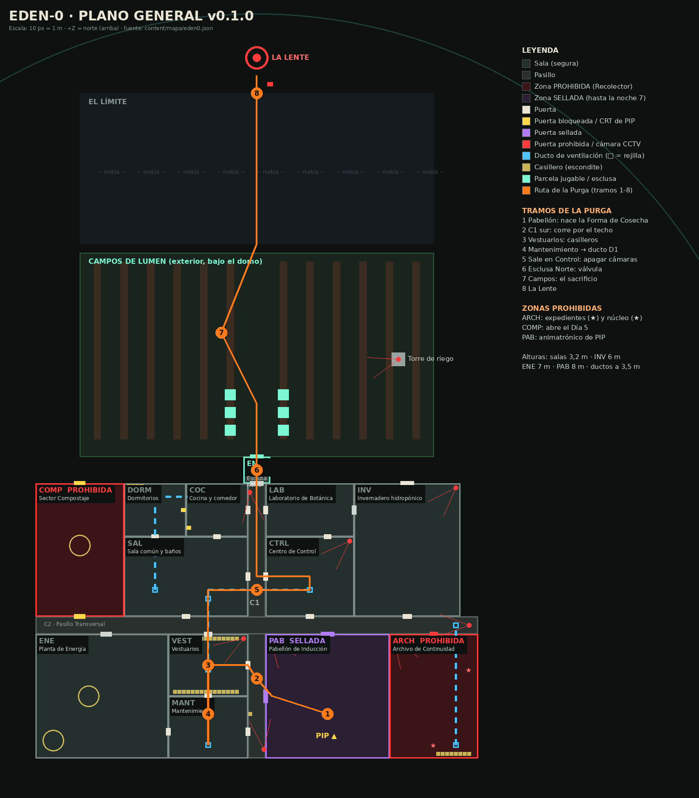
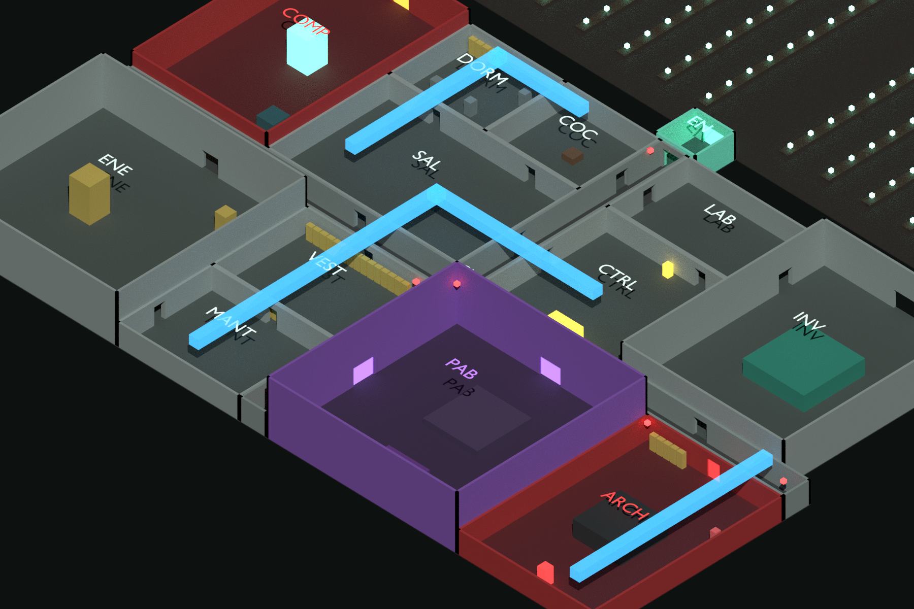

# Eden-0 · Mapa de la base v0.1.0

> **Documento 04 · Mapa.** Diseño de nivel del Capítulo 1: zonas, conexiones, ductos, casilleros, cámaras, rutas de las amenazas y la ruta de la Purga.
> **Fuente única:** `content/mapa/eden0.json`. Desde ese archivo se generan el plano 2D (`tools/render_map.py`), el modelo de bloques en Blender (`art/blender/build_base.py`) y la base jugable de la demo (`demo/src/world/world.js`, que lee una copia en `demo/data/`). Si se cambia el JSON, se regeneran los tres.





---

## 1. Concepto
Eden-0 es una **base industrial de un solo nivel bajo un domo**, con un **techo técnico** por donde corren los ductos. Combina dos espacios que juegan distinto:

- **El complejo interior** (pasillos estrechos, salas de 3,2 m de alto, luz fría y poca visibilidad), pensado para el **sigilo, la persecución y la claustrofobia**.
- **Los Campos de Lumen** (exterior bajo el domo), un espacio abierto y luminoso de día y peligroso de noche: ahí no hay dónde esconderse.

Las dos columnas vertebrales son el **Pasillo Central (C1)**, de norte a sur, y el **Pasillo Transversal (C2)**, de este a oeste. Todas las salas cuelgan de ellos, así que cualquier persecución termina pasando por uno de los dos. Por eso son el escenario natural de **Palimpsest caminando por el techo**.

**Cifras:** 15 espacios interiores (~6.100 m²), 25 puertas (3 prohibidas o selladas), 3 ductos con 9 rejillas, 48 casilleros, 9 cámaras CCTV y unos 3.700 m² de campo.

---

## 2. Zonas

| ID | Zona | Área / alto | Luz | Función de juego | Tareas | Amenaza | Props clave |
|---|---|---|---|---|---|---|---|
| **C1** | Pasillo Central | 248 m² · 3,2 m | Fría; roja en la Purga | Espina norte-sur; persecución por el techo | — | Recolector (noche) y Palimpsest | Cámaras norte y sur, casillero de servicio |
| **C2** | Pasillo Transversal | 400 m² · 3,2 m | Fría | Espina este-oeste; acceso a las zonas prohibidas | — | Recolector (noche) | Cámara este, rejilla del ducto D2 |
| **EN** | Esclusa Norte | 36 m² · 3,6 m | Fría | Salida a los campos. En la Purga necesita presión | Válvula (Purga) | — | Válvula roja |
| **DORM** | Dormitorios | 168 m² · 3,2 m | Cálida | Refugio, inicio de cada día, escena del Día 4 | — | Recolector (noches 4–6) | 3 literas, casilleros personales, CRT de PIP |
| **COC** | Cocina y comedor | 168 m² · 3,2 m | Cálida | Escenas sociales (cartas y votación) | Cocinar raciones | — | Mesa con cartas, encimera, nevera, CRT |
| **SAL** | Sala común y baños | 504 m² · 3,2 m | Cálida | Nudo del módulo habitacional. Trampilla al sótano | — | — | Sofás, cubículos, trampilla, rejillas D1 y D3 |
| **CTRL** | Centro de Control | 360 m² · 3,2 m | Pantallas | Cámaras, radio de VIGIL y CRT grande de PIP. Salida del ducto en la Purga | Fusibles, cámaras, radio | — | Muro de 16 monitores, radio, panel de fusibles |
| **LAB** | Laboratorio de Botánica | 240 m² · 3,2 m | Fría | Pistas científicas (ADN humano en el Lumen) | Escanear, limpiar filtros | — | Mesas con frascos de Lumen, escáner, filtro de esporas |
| **INV** | Invernadero hidropónico | 720 m² · 6 m (cristal) | Lumen | Cultivo interior y conexión con la granja | Cultivo interior | — | 4 bastidores de 22 m, aspersores |
| **COMP** | Sector Compostaje | 600 m² · 5 m | Roja | **PROHIBIDA** hasta el Día 5. Origen del Recolector | Sabotear el contador | Recolector | Biorreactor de cristal, montaña de uniformes, terminal "CUERPO" |
| **ENE** | Planta de Energía | 840 m² · 7 m | Ámbar | El punto más ruidoso del mapa | Calibrar el generador, convertidor | Recolector (noche) | Generador, convertidor, panel de agujas, silo, pizarra de cuota |
| **VEST** | Vestuarios | 252 m² · 3,2 m | Fría | **Escondite principal**: dos filas de casilleros | — | Palimpsest (Purga) | 30 casilleros, bancos, cámara roja |
| **MANT** | Mantenimiento | 252 m² · 3,2 m | Ámbar | Herramientas, señuelos y **entrada al ducto D1** | Desatascar ductos | — | Estanterías, tuberías, rejilla con escalerilla |
| **PAB** | Pabellón de Inducción | 784 m² · 8 m | Escenario | **SELLADO** hasta la noche 7. Ceremonia y nacimiento de la Forma de Cosecha | — | Palimpsest | Escenario con telón, butacas, muro de dibujos (Charlie), cartel de bienvenida |
| **ARCH** | Archivo de Continuidad | 560 m² · 3,2 m | Roja | **PROHIBIDA**. Guarida del Recolector y expedientes de memoria | Incursiones (Días 3 y 6) | Recolector (siempre) | 4 filas de servidores, gabinete de expedientes, núcleo, casilleros, rejilla D2 |
| **FARM** | Campos de Lumen | ~3.700 m² | Domo / Lumen | Cultivo y el tramo abierto de la Purga | Sembrar, regar, cosechar, cargar sacos | Recolector (noche) y Palimpsest (Purga) | 12 surcos, 6 parcelas, placas, **torre de riego** (12 m) con cámara |
| — | El Límite y La Lente | — | Niebla | Final | — | — | Árboles muertos, rocas, placa de VIGIL, lente de 11 m en el muro del domo |

---

## 3. Conexiones y reglas de acceso

- **Puertas normales (blanco):** abiertas de día y cerrables de noche (barricadas).
- **Bloqueadas (amarillo):** el Compostaje (`comp_c2` y `comp_farm`). Se abren el **Día 5** por anuncio de Recepción.
- **Selladas (violeta):** las del Pabellón (`pab_c1` y `pab_c2`). Se abren solo en la **noche 7**.
- **Prohibida (rojo):** la del Archivo (`arch_c2`). Tiene lector de gafete: **Claire** la abre o el despierto usa su gafete. Si el Recolector te oye dentro, la puerta **se cierra** y la única salida es el **ducto D2**.
- **Esclusa (cian):** `en_farm`. En la Purga necesita presión (válvula).

## 4. Ductos de ventilación
Corren a **3,5 m** de altura, por encima de los techos de 3,2 m. Miden 1,4 × 1,3 m: se avanza **agachado/arrastrándose** a 1,7 m/s, con la cámara pegada y viñeta cerrada. Cada rejilla tiene una escalerilla. Arrastrarse por el metal hace ruido (0,35) y abrir una rejilla hace más (0,6).

| Ducto | Recorrido | Rejillas | Uso |
|---|---|---|---|
| **D1 · Ducto Oeste** | MANT → VEST → C2 → SAL → (giro) → C1 → CTRL | MANT, VEST, SAL, CTRL | **Tramo 4 de la Purga**: de Mantenimiento al Centro de Control. Palimpsest entra detrás, encogido |
| **D2 · Ducto del Archivo** | Fondo del ARCH → C2 | ARCH, C2 | Escape de las incursiones al Archivo |
| **D3 · Ducto de los dormitorios** | SAL → DORM → COC | SAL, DORM, COC | Por aquí entra el Recolector la noche 4 (se le oye sobre el techo) |

## 5. Casilleros (48)
Dos filas de 15 en **Vestuarios**, 5 + 8 en el **Archivo**, 4 en **Dormitorios** y 1 de servicio en **C1**. Reglas:
- Entrar o salir: **E**. Desde dentro se ve por la rendija (overlay de lamas).
- **Contra el Recolector (oído):** mantener **Espacio** para contener la respiración (la barra baja un 22 %/s y se recupera un 30 %/s). Si respiras con él a menos de 3,2 m, abre la puerta.
- **Contra Palimpsest (vista):** que no te **vea entrar**. Si una cámara roja o sus ojos te ven, irá directo a ese casillero. Si no, al llegar a tu última posición conocida revisa al azar hasta tres casilleros cercanos.

## 6. Cámaras CCTV (9)
`cam_c1_s`, `cam_c1_n`, `cam_c2_e`, `cam_vest`, `cam_ctrl`, `cam_arch`, `cam_inv`, `cam_tower` y `cam_pab`. De día las mira Elliot en el muro de monitores (con 5 s de retraso). En la Purga son **los ojos de Palimpsest**: luz roja intermitente, cono de 100° y 20 m de alcance, y solo ven dentro de su propia sala. Desde el **muro de monitores** se apagan 22 s (tramo 5).

## 7. Rutas de las amenazas
- **Recolector, de día:** patrulla un rectángulo entre las filas de servidores del ARCH (6 puntos). Va hacia cualquier ruido **dentro de su zona** y nunca sale de ella.
- **Recolector, de noche:** patrulla C2 → C1 → puertas del módulo habitacional → ENE (el generador lo atrae). Desde la noche 4 usa el ducto D3.
- **Palimpsest (Purga):** grafo de navegación completo (salas, puertas, pasillos, ductos y campo). Corre por el **techo** en C1 y C2 cuando está a más de 5 m, baja al suelo para atacar y entra en los ductos encogido. Su velocidad es 3,4 + 0,025 × CUERPO % (máximo 5,4 m/s; el jugador corre a 5,2). Con CUERPO < 60 % **tropieza** de vez en cuando.

## 8. La ruta de la Purga (tramos 1–8)
| # | De → a | Mecánica | Punto de control |
|---|---|---|---|
| 1 | **PAB** (escenario) → puerta oeste | Cinemática de transformación y huida entre butacas | Puerta `pab_c1` |
| 2 | **C1 sur** | Palimpsest corre por el techo; las luces estallan | C1 (z −30) |
| 3 | **VEST** | Casillero fuera del cono de `cam_vest`; contener la respiración | VEST |
| 4 | **MANT → ducto D1** | Arrastrarse 60 m; garras detrás | Rejilla de MANT |
| 5 | **CTRL** | Apagar cámaras (mantener E): 22 s de ceguera | CTRL |
| 6 | **C1 norte → EN** | Válvula (Oliver o tú) y esclusa | EN |
| 7 | **FARM** | El sacrificio: un compañero grita frente a la cámara de la torre | Campo (z 34) |
| 8 | **El Límite → La Lente** | Placa de VIGIL (archivo 5) y el final | — |

## 9. Reglas de diseño de nivel (para iterar el mapa)
1. **Todo escondite tiene salida doble:** cada sala con casilleros tiene al menos dos puertas o una rejilla.
2. **Nunca más de 25 m sin escondite** en la ruta de la Purga.
3. **Bucles:** C1 + C2 + SAL forman un bucle que permite despistar sin escondite.
4. **Ruido localizado:** ENE es el punto más ruidoso y sirve de señuelo natural contra el Recolector.
5. **Silueta y luz:** las zonas prohibidas son rojas y las selladas, violetas, y se distinguen desde el pasillo por el color de la franja de la puerta.
6. **Móvil:** salas de 3,2 m de alto con techo (oclusión natural), niebla interior a 26 m y un pool de 6 luces dinámicas que se reparte entre las lámparas más cercanas.

## 10. Cómo regenerar
```bash
python3 tools/render_map.py
```
```bash
python art/blender/build_base.py
```
```bash
bash tools/sync_demo.sh
```
El primero genera el plano, el segundo el `.blend` y los renders isométricos (con bpy 5.x), y el tercero copia el JSON y los modelos a la demo.
